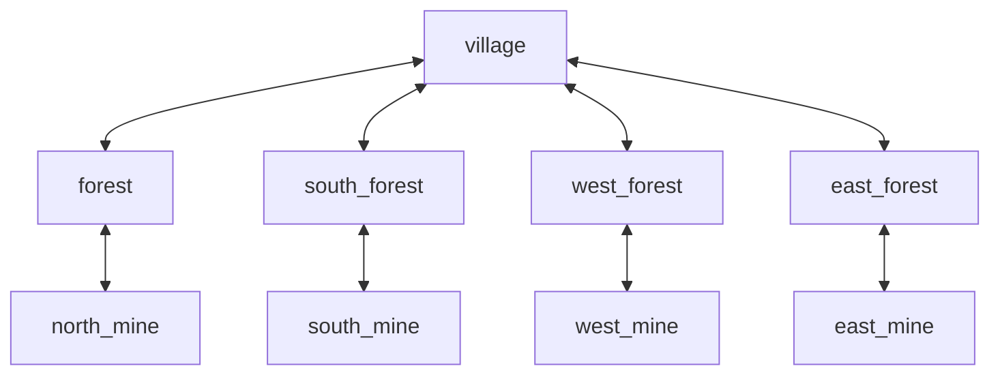

# Eldoria — Kareden Altıgene Geçiş Planı

**Durum:** Aşama 0 planı; dönüşüm uygulanmadı.  
**Kaynak snapshot:** `demo_eldoria` @ `5e77ef0cd70d1bc439ef2eb0bd2d5b86302ef9fc`

## 1. Mevcut dokuz haritanın envanteri

Dokuz dosyanın tamamı schema v1, 32×32 boyut ve `grass` varsayılan zemini kullanır. Her birinde `world_position` mevcut; yalnızca `village` `starting_position=[16,29]` taşır.

| ID | Görünen ad | world_position (mevcut) | Başlangıç | Landmark özeti | Geçiş |
|---|---|---:|---|---|---|
| village | Köy | [180,220] | [16,29] | 16 yapı/gate | forest N, south_forest S, west_forest W, east_forest E |
| forest | Kuzey Ormanı | [180,50] | — | 5 ağaç + 1 maden | village S, north_mine E |
| north_mine | Kuzey Maden Haritası | [300,50] | — | 1 maden | forest W |
| east_forest | Doğu Ormanı | [330,220] | — | 3 ağaç + 1 maden | village W, east_mine E |
| east_mine | Doğu Maden Haritası | [480,220] | — | 1 maden | east_forest W |
| south_forest | Güney Ormanı | [180,390] | — | 3 ağaç + 1 maden | village N, south_mine E |
| south_mine | Güney Maden Haritası | [300,390] | — | 1 maden | south_forest W |
| west_forest | Batı Ormanı | [30,220] | — | 3 ağaç + 1 maden | village E, west_mine S |
| west_mine | Batı Maden Haritası | [30,390] | — | 1 maden | west_forest N |

Not: `world_position` mevcut kodda `Location.position` olarak world map renderer'a aktarılır; bu değerler axial koordinat değil, mevcut sunum yerleşimi için piksel benzeri x/y'dir. Yeni world axial konumlarına bire bir kopyalanmamalıdır.

### Harita ayrıntıları

- `village`: 194 blocked tile; river 64 tile, bridge 2 tile, wall 120 tile; 16 landmark; 4 tek hücreli çıkış. Başlangıç [16,29].
- `forest`: 62 blocked tile; river 64 tile ve bridge 2 tile; 6 kaynak landmark'ı; 2 geçiş.
- `east_forest`: 62 blocked; river 64, bridge 2; 4 kaynak landmark'ı; 2 geçiş.
- `west_forest`: 62 blocked; river 64, bridge 2; 4 kaynak landmark'ı; 2 geçiş.
- `south_forest`: 62 blocked; river 64, bridge 2; 4 kaynak landmark'ı; 2 geçiş.
- `north_mine`, `south_mine`, `east_mine`, `west_mine`: her biri 62 blocked; river 64, bridge 2; bir demir maden landmark'ı; bir geçiş.

Landmark sayıları toplam 38'dir: 22 kaynak landmark'ı (18 orman kaynağı + 4 maden haritası madeni) ve köyde 16 yapı/gate. Resource JSON'da 21 node kaydı bulunur; bunlar map landmark'larına ID üzerinden bağlanır. NPC JSON'da 4 NPC vardır; hepsi köyde konumlanır. NPC ve resource konumları ayrı JSON dosyalarında tutulur.

### Mevcut bağlantı grafiği

Tüm mevcut çıkışlar `bidirectional=true`; her biri tek hücre kaynak ve tek hücre hedef kullanır. Mevcut doğrulayıcı ters geçiş kaydını ve ters hücre kümelerini kontrol eder. Kaynak yönleri dört cardinal değerle sınırlıdır.

Bağlantılar fiziksel geçiş kayıtlarından türetilen WorldMap kenarlarıdır. Mevcut loader dünya koordinatlarının geometrik komşu olup olmadığını doğrulamaz; yalnızca hedef map varlığını, hedef koordinat sınırını ve bidirectional reciprocal kaydını denetler.

## 2. Kare modelin gerçek kullanım noktaları

- `MapDefinition`: width/height, tuple[int,int], blocked_tiles, feature tiles, landmark position, transition from/target tiles.
- `LocalMapDefinition`: width/height bounds.
- `MovementManager.set_tile_position`: x/y bounds kontrolü ve Position(x,y).
- `WorldObjectPlacement`: x/y + width/height kare footprint; occupied_tiles dikdörtgeni.
- `MainScreen`: TILE_SIZE=16, x/y grid, dört komşulu BFS, Manhattan geçiş hedefi seçimi, kare bounds ve piksel bölme ile mouse selection.
- `content_pack.py`: NPC/resource/market position'larını x/y tuple olarak doğrular ve Position(x,y) oluşturur.
- `SocialSnapshot`, `ActorSnapshot`, `ContainerSnapshot`: x/y ve placement footprint alanlarını saklar.
- `Camera`: yalnızca x/y piksel kaydırması; `ScaledRenderer` DPI ölçeklemesi yapar, kamera zoom'u değildir.

## 3. Otomatik ve kontrollü dönüşüm karşılaştırması

### A. Matematiksel otomatik dönüşüm

Odd-r row-offset → axial taslağı: `q = x - floor(y/2)`, `r = y`. Bu deterministik ve geri üretilebilir bir başlangıç eşlemesidir. Eski yatay/dikey komşulukları altıgen komşu olur; ancak eski karede çapraz olan bazı hücreler de altıgen komşu hale gelir. Bu nedenle yeni hareket rotaları, engel sınırları ve geçiş bağlantıları değişebilir. Kare çoklu hücre footprint'i altıgen alanda dikdörtgen olarak anlamlı değildir.

Avantaj: hızlı ilk dönüşüm, eski hücre başına otomatik eşleme, büyük arazi maskeleri için başlangıç. Risk: yeni kısayollar, kapı/nehir/köprü şeklinin değişmesi, üst üste binen nesneler, ekran yerleşimi ve etkileşim mesafelerinin bozulması.

### B. Dokuz haritayı içerik bazlı yeniden düzenleme

Her harita axial hücreler üzerinde yeniden tasarlanır. Geçiş koridorları, nehir, köprü, duvar, yapı ve kaynakların konumu altı komşulukla yeniden seçilir. Daha kontrollüdür ve görsel kaliteyi korur; ancak dokuz haritanın tamamında elle tasarım/doğrulama gerektirir.

### Karar: hibrit

1. Otomatik offset→axial eşlemesi yalnızca ilk taslak/rapor üretir.
2. Bütün dokuz harita içerik bazında gözden geçirilir; maskeler ve kritik geçiş koridorları elle düzenlenir.
3. Her eski coordinate/entity için deterministik eşleme tablosu tutulur.
4. ID'ler korunur: map_id, NPC ID, landmark ID, resource node ID, transition ID, quest ID.
5. Hiçbir nesne sessizce silinmez, başka hücreye taşınmaz veya en yakın geçerli hücreye atanmaz.
6. Otomatik rapor; eşlenmeyen, çakışan, geçersiz, kaybolan ve yeni komşuluk açan her hücreyi hata/uyarı olarak gösterir.
7. Eski ve yeni paketler paralel doğrulanır; kabul sonrasında eski format için deprecate kararı ayrı aşamada alınır.

## 4. Dönüşüm manifesti

Migration aracı her harita için aşağıdaki mantıksal kayıtları üretmelidir:

- Kaynak kimlik: package_id, map_id, source_schema_version.
- Eski hücre: x, y.
- Yeni hücre: q, r.
- Kaynak nesne kimliği/türü (varsa): actor/NPC/landmark/resource/feature/object/transition.
- Dönüşüm yöntemi ve sürümü.
- Durum: mapped, reviewed, conflict, missing, intentionally_removed.
- İçerik inceleme notu.

Aynı source tuple her çalıştırmada aynı axial tuple üretmelidir. Elle düzeltilen eşlemeler otomatik sonuçtan ayrı, açık override olarak tutulmalıdır. Migration sonucu ve rapor hash'i kaydedilebilir.

## 5. Varlık bazlı strateji

| İçerik | Dönüşüm yaklaşımı |
|---|---|
| Oyuncu başlangıcı | `village [16,29]` için elle seçilmiş geçerli hücre; oyuncu ID korunur |
| NPC | 4 NPC'nin her biri ID bazlı taşınır; NPC'nin yeni hücresi maskede ve etkileşime uygun olmalı |
| Kaynak | 22 resource node ve 22 resource landmark ilişkisi ayrı ayrı doğrulanır; kimlik bağı kopmaz |
| Arazi | default terrain korunur; valid-cell mask ve terrain override axial hücrelere göre yeniden hazırlanır |
| Engeller | blocked tile'lar geçilebilirlik maskesiyle tutarlı biçimde çevrilir |
| Landmark/yapı | 38 landmark'ın tamamı tekil ID ve hücre eşlemesiyle taşınır; köy footprint'i elle düzenlenir |
| Büyük nesne | kare width/height footprint yerine hücre kümesi (occupied axial cells) kullanılır |
| Kapı/geçiş | kaynak/target cell pair ve yön karşılığı açıkça eşlenir |
| Köprü/nehir | özellik hücreleri ve geçilebilirlik ilişkisi görsel ve yol bulma testleriyle yeniden çizilir |
| Görsel metadata | kimlik, visual_type ve stil anahtarları korunur; geometri/pivot/anchor yeni renderer'a göre uyarlanır |

## 6. Kayıt migration politikası

Mevcut application save envelope `rpg-game-save` v2; actor/social/container gibi alt snapshot'lar kendi schema version'larını taşır. Actor ve NPC pozisyonları `Position{x,y}`; container placement `x,y,width,height` olarak saklanır. Save migration mevcut durumda v0→v1→v2 ve legacy NPC konum tamamlama adımlarını içerir; axial migration henüz yoktur.

Axial save migration yeni bir envelope sürümünde planlanmalıdır. Eski save önce salt okunur şekilde parse edilir; aktif content package ve dönüşüm manifestiyle map_id bazında koordinat eşlemesi yapılır. Yedek alınır; yeni save ayrı geçici dosyaya yazılır, tekrar okunur, cross-reference ve valid-cell kontrolünden geçer. Başarılı doğrulama sonrasında yeni dosya etkinleştirilir. Orijinal dosya korunur.

Bir koordinat eşlemesi bulunamazsa, harita kimliği bilinmiyorsa, target cell maskede yoksa veya iki kritik nesne aynı hücreye düşerse migration durur ve anlaşılır uyumluluk hatası verir. Tahmini fallback/nearest-cell relocation yasaktır. Migration idempotent ve deterministik olmalıdır.

## 7. Aşama sırası ve çıkış kriterleri

1. **Aşama 0 — Teknik sözleşme/envanter:** tamamlanmadan geometri kodu yazılmaz.
2. **Aşama 1 — Hex geometri:** immutable axial value object, direction/opposite, distance, property tests.
3. **Aşama 2 — Masked local map:** geçerli hücre kümesi, JSON schema, loader ve içerik paketi izolasyon testleri.
4. **Aşama 3 — World map:** WorldHexPosition, dünya komşuluğu, altı yönlü geçiş ve reciprocal validator.
5. **Aşama 4 — Hareket/pathfinding:** altı komşu BFS/A*, engel ve unreachable testleri.
6. **Aşama 5 — Pygame renderer/input:** pointy-top çizim, kamera dönüşümü, fare seçimi, zoom.
7. **Aşama 6 — Actor/NPC/resources/objects:** konum ve occupancy adaptörleri.
8. **Aşama 7 — Persistence/content migration:** eski kayıt ve dokuz haritanın dönüşümü, bağımsız paket doğrulaması, full regression.

Her aşama sonunda test matrisi ve elle oynanış kabulü imzalanmadan sonraki aşama açılmaz. Aşama 0 sonunda durulur.
