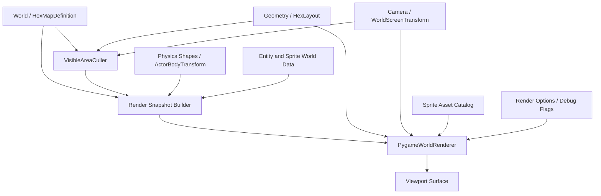

# Aşama 7 — Render ve Görsel Doğrulama Teknik Mimari Planı

> **Belge türü:** Ayrıntılı teknik mimari, veri/API sözleşmeleri, uygulama sırası ve doğrulama planı  
> **Proje:** Eldoria — Hex World Laboratory  
> **Çalışma dalı:** `experiment/hex-world-laboratory`  
> **Durum:** KULLANICI ONAYLADI — 7.1–7.8 UYGULAMA VE OTOMATİK DOĞRULAMA TAMAMLANDI — MANUEL GÖRSEL KABUL BEKLENİYOR  
> **Ön koşullar:** Aşama 0–6 kabul edildi; Aşama 7 genel planı kullanıcı tarafından onaylandı.  
> **Kod durumu:** 7.1–7.8 uygulaması tamamlandı; otomatik doğrulama başarılı; kullanıcı manuel görsel kabulü bekleniyor.

---

## 1. Teknik hedef

Aşama 7, Aşama 6 sonunda kabul edilen kamera ve dünya-ekran dönüşümünün üzerine, mevcut hex dünya verisini doğru ve verimli biçimde çizen bir render pipeline kuracaktır.

Render katmanı; hex hücrelerini, dünya nesnelerini, sprite'ları, derinlik sırasını ve fiziksel collider debug görünümünü tek bir koordinat sözleşmesi üzerinden sunacaktır. Görsel konumlandırma, kamera hareketi ve optimizasyonlar simülasyonun yetkili dünya durumunu değiştirmeyecektir.

Aşamanın temel teknik sonucu şudur:

- Geometri çekirdeği hex şeklinin tek doğruluk kaynağı olmaya devam eder.
- Render girdisi bir frame için hazırlanmış immutable dünya-görünüm snapshot'ıdır.
- Kamera dönüşümü bir frame içinde tek ve tutarlı biçimde uygulanır.
- Görünür alan dışındaki hücre ve nesneler çizim hazırlığına gereksiz yere alınmaz.
- Sprite'ın görsel foot-anchor noktası, fiziksel aktörün ground-anchor konumuyla eşleşir.
- Y-sort, nesnelerin zemin temas noktasına göre kararlı ve tekrarlanabilir çalışır.
- Debug çizimleri normal dünya çiziminden ayrıdır.
- Performans iddiaları aynı sahnede, culling açık/kapalı karşılaştırmasıyla kanıtlanır.

Aşama 7, yeni bir simülasyon, hareket veya yol bulma sistemi geliştirme aşaması değildir.

## 2. Devralınan mevcut mimari ve doğrulanmış durum

Plan, yalnızca `experiment/hex-world-laboratory` dalındaki mevcut kod ve belgeler esas alınarak hazırlanmıştır.

### 2.1 Mevcut render altyapısı

| Dosya | Mevcut sorumluluk | Aşama 7 açısından durum |
|---|---|---|
| `rendering/snapshot.py` | Pygame bağımsız immutable `CellVisual`, `CircleVisual`, `PolygonVisual`, `LineVisual`, `WorldRenderSnapshot` veri nesneleri | Genişletilecek; sprite, depth ve collider-debug verileri henüz yok |
| `rendering/pygame_world_renderer.py` | Snapshot verisini Pygame Surface üzerine çizer ve kamera dönüşümünü uygular | Şu anda tek render metodu içinde; tüm hücreleri çizer, culling ve Y-sort uygulamaz |
| `application/movement_demo.py` | Dünya, hareket, çarpışma, kamera ve render akışını birleştirir | `build_render_snapshot()` mevcut haritanın bütün hücrelerini snapshot'a alır |
| `camera/transform.py` | World ↔ screen dönüşümü | Float koordinat üretir; Y eksenini tek noktada ters çevirir |
| `geometry/layout.py` | Hex yönelimi, circumradius ve origin | Hex geometrisinin parametre kaynağı |
| `geometry/polygon.py` | `hex_polygon()`, `hex_corners()`, `hex_edges()` | Hücre çizimi aynı geometri API'sini kullanmalı |
| `physics/body.py` | `BodyDefinition`, `ActorBodyTransform`, ground-anchor tabanlı collider dönüşümü | Sprite foot-anchor ile fiziksel zemin noktasını eşlemek için kullanılacak |
| `physics/obstacle.py` | Dünya koordinatına dönüştürülebilen statik collider tanımları | Collider debug snapshot'ının kaynaklarından biri |
| `tests/integration/test_pygame_world_renderer.py` | Flat-top/pointy-top ve kamera dönüşümü çizim doğrulaması | Yeni render testlerinin başlangıç noktası |
| `tests/integration/test_movement_demo_render.py` | Render sırasında simülasyon state'inin değişmediğini doğrular | Aşama 7 regresyon kapısı olarak korunacak |

### 2.2 Bugünkü sınırlamalar

1. Renderer, `snapshot.cells` içindeki her hücreyi dolaşıp çizer. Görünür alan sorgusu yoktur.
2. Snapshot oluşturulurken `HexMapDefinition.cells` içindeki tüm hücreler `CellVisual` nesnelerine dönüştürülür. Bu nedenle yalnızca renderer içinde çizimi atlamak, snapshot hazırlama maliyetini ortadan kaldırmaz.
3. Hücre merkezi, koordinat etiketi ve bağımsız debug katmanı için render seçenekleri bulunmaz.
4. Snapshot içinde sprite varlığı, sprite foot-anchor'ı veya derinlik anahtarı bulunmaz.
5. Aktör mevcut prototipte daire olarak çizilir; sprite ve fiziksel ground-anchor eşleştirmesi henüz yapılmamıştır.
6. Dünya nesneleri sabit koleksiyon sırasıyla çizilir; ortak Y-sort kuyruğu yoktur.
7. Dünya çizimi ile collider debug çizimi ayrı sunum katmanları olarak tanımlanmamıştır.
8. Kamera dönüşümü float değer üretse de Pygame raster çizim sınırında koordinatlar tam sayıya yuvarlanır. Bu davranışın hareket sırasında algılanan etkisi henüz ölçülmemiştir.

Bu sınırlamalar yeni bir mimariyi gerekçelendirmek için kaydedilmiştir; mevcut çalışan kamera, geometri, hareket veya fizik sistemlerinin yeniden yazılmasını gerektirmez.

## 3. Mimari kararlar ve değişmezler

### 3.1 Koordinat sahipliği

- `AxialCoord`: hücrenin mantıksal adresidir.
- `WorldPoint`: aktör, sprite ground-anchor'ı, collider ve dünya nesnelerinin yetkili dünya konumudur.
- `ScreenPoint`: kamera dönüşümü sonrasındaki ekran koordinatıdır.
- Render katmanı hiçbir zaman `ScreenPoint` değerini dünya state'ine geri yazmaz.
- Sprite foot-anchor, `WorldPoint` olarak ifade edilen ground-anchor'ın görsel pivot eşidir.

### 3.2 Geometri tek doğruluk kaynağı

Hex hücreleri için renderer yeni köşe/merkez matematiği yazmayacaktır. Hücre geometrisi mevcut `HexLayout`, `axial_to_world()` ve `hex_polygon()` API'lerinden alınacaktır. Culling hesabı da aynı layout ve yönelim parametrelerini kullanacaktır.

### 3.3 Immutable render girdisi

Renderer simülasyon nesnelerine doğrudan erişmeyecektir. Uygulama katmanı, o frame'de çizilecek verileri immutable snapshot'a dönüştürür. Renderer yalnızca snapshot, layout, kamera transform'u, render seçenekleri ve gerekli görsel asset kataloğunu alır.

### 3.4 Tek kamera transform'u

Bir render frame'i için kullanılan transform snapshot'ı sabitlenir. Hücreler, sprite'lar, collider overlay ve dünya debug işaretleri aynı `WorldScreenTransform` örneğiyle dönüştürülür. Aynı frame içinde kamera state'i yeniden okunarak farklı nesnelerin farklı transform kullanması engellenir.

### 3.5 Simülasyon izolasyonu

Render, culling, Y-sort, sprite yerleşimi, debug görünümü ve pixel snapping araştırması:
- MovementSystem çağırmaz.
- Tick pump ilerletmez.
- MovementState, world runtime, collision geometry veya cell tracker verisini değiştirmez.
- Collider boyutunu zoom'a göre değiştirmez.
- Kamera state'ini yalnızca çizim amacıyla değiştirmez.

### 3.6 Pygame bağımlılığı

Geometry, World, Physics ve snapshot veri nesneleri Pygame bağımlılığı kazanmaz. Pygame Surface, Font, draw ve image işlemleri `rendering/pygame_world_renderer.py` ve Pygame'e özel asset adaptörlerinde kalır.

## 4. Hedef render pipeline

Bir frame için hedef işlem sırası:

1. **Frame context oluşturma:** Kamera transform'u, viewport, layout ve render seçenekleri bir kez alınır.
2. **Görünür alan hesaplama:** Viewport'un dünya uzayındaki görünür sınırları hesaplanır.
3. **Render snapshot hazırlama:** Yalnızca görünür hücre ve dünya nesneleri immutable render DTO'larına dönüştürülür.
4. **Zemin katmanı:** Arka plan ve hex dolgu yüzeyleri çizilir.
5. **Hex sınır katmanı:** Hücre kenarları ve seçili/aktif hücre vurguları çizilir.
6. **Dünya nesneleri:** Görsel nesneler ground-anchor Y değerine göre sıralanıp çizilir.
7. **Aktör/sprite çizimi:** Aktör de aynı derinlik kuyruğuna katılır; özel olarak daima en önde çizilmez.
8. **Collider debug katmanı:** İstenmişse fiziksel collider geometrileri çizilir.
9. **Geometri debug katmanı:** Hücre merkezleri, koordinat etiketleri ve debug sınırları çizilir.
10. **Screen-space diagnostics:** FPS ve teknik tanı paneli gibi ekran sabitli UI çizilir.

Zemin ve hex çizimleri derinlik kuyruğundan önce gelir. Dünya nesneleri ile aktör aynı Y-sort kuralına tabi olur. Debug katmanları normal dünya görsellerini değiştirmez; yalnızca ek overlay üretir.

## 5. Çalışma paketi 7.1 — Hex çizim sırası ve görünür alan culling

### 5.1 Hedef

Büyük haritalarda viewport dışında kalan hücrelerin snapshot hazırlama ve çizim maliyetini azaltmak; görünür alanın kenarından geçen hücreleri eksik çizmeden güvenli bir aday kümesi üretmek.

### 5.2 Önerilen mimari

Yeni yardımcı modül:

- `src/hex_world_lab/rendering/visibility.py`

Önerilen sorumluluklar:

- Viewport köşelerini mevcut transform ile dünya koordinatına dönüştürmek.
- Görünür dünya AABB'sini hesaplamak.
- Hex circumradius kadar güvenlik payı eklemek.
- Genişletilmiş dünya AABB'sini `world_to_fractional_axial()` ile axial koordinat aralığına çevirmek.
- Aday q/r aralığına bir hücrelik ek güvenlik payı uygulamak.
- Haritanın mevcut hücre sözlüğünde yalnızca aday koordinatları sorgulamak.
- Görünür alanla kesişmeyen nesne/collider AABB'lerini snapshot'a almamak.

### 5.3 Culling algoritması

1. Viewport'un dört köşesi `screen_to_world()` ile world space'e çevrilir.
2. Dört noktanın min/max x/y değerlerinden viewport world AABB'si oluşturulur.
3. AABB, her yönde en az `layout.radius` kadar genişletilir. Bu pay, merkezi viewport dışında olduğu hâlde hex polygon'u viewport'a taşan hücreleri korur.
4. Genişletilmiş AABB'nin dört köşesi `world_to_fractional_axial()` ile fractional q/r değerlerine dönüştürülür.
5. q/r min/max değerleri aşağı/yukarı yuvarlanır ve konservatif bir hücre payı eklenir.
6. Bu aralıktaki koordinatlar `definition.cells` sözlüğünde doğrudan aranır. Böylece haritanın bütün hücreleri taranmaz.
7. İsteğe bağlı ikinci aşamada aday hex polygon'un viewport AABB'siyle kesişimi kontrol edilir. Bu aşama yalnızca fazla adayları azaltmak için kullanılabilir; ilk aşamanın güvenliğini daraltamaz.
8. Görünür hücreler snapshot'a alınır ve çizim sırasına göre deterministik biçimde düzenlenir.

Axial q/r aralığı konservatif aday üreticisidir; düzensiz/eksik hücre kümelerinde olmayan hücreler üretilmiş sayılmaz. Hücre varlığı son aşamada dünya haritası sözlüğünden doğrulanır.

### 5.4 Sınır ve doğruluk kuralları

- Culling hiçbir görünür hücreyi atlamamalıdır (false negative kabul edilmez).
- Fazladan aday hücre üretmek kabul edilebilir; bunlar performans ölçümünde raporlanır.
- Flat-top ve pointy-top aynı algoritma sözleşmesini kullanır; fractional axial dönüşümü orientation farkını ele alır.
- Negatif q/r koordinatları, harita origin kayması ve zoom seviyeleri test edilir.
- Viewport dışındaki hücreleri çizmemek, dünya hücresini silmek veya harita verisini değiştirmek anlamına gelmez.
- Culling devre dışı bırakıldığında referans görünüm, mevcut tüm hücrelerin çizildiği davranışla eşleşmelidir.

### 5.5 Önerilen API

```python
@dataclass(frozen=True, slots=True)
class VisibleRegion:
    world_min_x: float
    world_min_y: float
    world_max_x: float
    world_max_y: float

class VisibleAreaCuller:
    def visible_cells(
        self,
        cells: Mapping[AxialCoord, HexCellData],
        layout: HexLayout,
        transform: WorldScreenTransform,
    ) -> tuple[AxialCoord, ...]: ...

    def visible_region(
        self,
        transform: WorldScreenTransform,
        layout: HexLayout,
    ) -> VisibleRegion: ...
```

İsimler öneridir; uygulama öncesinde mevcut kodun tip ve API biçimiyle uyumlu hâle getirilecektir. Culler dünya nesnesini değiştirmez.

### 5.6 Testler

- Dört viewport kenarına taşan hücreler eksiksiz bulunur.
- Viewport'un tam dışında kalan hücreler elenir.
- Hücre merkezi viewport dışında, polygon'u viewport içinde olan hücre korunur.
- Flat-top ve pointy-top sonuçları doğrulanır.
- Negatif axial koordinatlarda sonuç doğrudur.
- Kamera pan, zoom ve resize sonrasında görünür hücre kümesi güncellenir.
- Culling açık çizim ile culling kapalı çizimin viewport içindeki piksel sonucu eşdeğerdir.
- Büyük haritada aday hücre sayısı tüm harita hücresi sayısından belirgin biçimde düşük olur.

## 6. Çalışma paketi 7.2 — Hücre sınırları, merkezleri, koordinat etiketleri ve debug katmanları

### 6.1 Render seçenekleri

Yeni immutable render seçenekleri tanımlanır. Önerilen alanlar:

- `show_hex_edges`
- `show_cell_centers`
- `show_coordinate_labels`
- `show_collider_debug`
- `show_culling_debug`

Varsayılan normal görünümde yalnızca temel dünya çizimi açıktır. Koordinat yazıları ve debug overlay varsayılan olarak kapalıdır.

### 6.2 Çizim kuralları

- Hücre sınırları `hex_polygon(coord, layout)` üzerinden üretilir.
- Hücre merkezi `axial_to_world(coord, layout)` ile hesaplanır.
- Merkez işareti dünya noktasından aynı kamera transform'u ile ekrana taşınır.
- Koordinat etiketi `q, r` biçiminde gösterilir.
- Font boyutu ekran pikseli cinsinden sabit tutulur; kamera zoom'u yazıyı dünya nesnesi gibi büyütmez.
- Etiket ve merkez işareti yalnızca görünür hücreler için çizilir.
- Seçili/aktif hücre vurgusu mevcut `selected_cell` ve aktif hücre bilgisini kullanır; simülasyon verisi değiştirilmez.

### 6.3 Testler

- Hücre merkezi işareti geometrik merkezle piksel toleransı içinde çakışır.
- Koordinat etiketi doğru axial q/r değerini gösterir.
- Debug seçenekleri kapalıyken debug çizimi yapılmaz.
- Debug seçenekleri açılıp kapatıldığında dünya state'i aynı kalır.
- Kamera pan/zoom sırasında etiketler doğru hücreyi takip eder.
- Farklı viewport boyutlarında etiketler viewport dışına çizilmez.

## 7. Çalışma paketi 7.3 — Sprite foot-anchor ve dünya konumu eşleştirmesi

### 7.1 Temel kavram

Fiziksel aktörün yetkili konumu, `ActorBodyTransform.ground_anchor` ile temsil edilen zemin temas noktasıdır. Sprite'ın ekranda çizileceği nokta, görselin ayak/pivot ankrajıdır. Sprite'ın sol üst köşesi aktör konumu değildir.

Sprite kaynağı ve foot-anchor verisi Pygame bağımlı olabilir; ancak snapshot içindeki dünya konumu Pygame bağımsız `WorldPoint` olmalıdır.

### 7.2 Önerilen veri sözleşmesi

Snapshot tarafında:

```python
@dataclass(frozen=True, slots=True)
class SpriteVisual:
    visual_id: str
    asset_key: str
    ground_anchor: WorldPoint
    depth_anchor_y: float
```

Pygame render/asset tarafında:

```python
@dataclass(frozen=True, slots=True)
class SpriteAsset:
    surface: pygame.Surface
    foot_anchor_x: float  # normalized 0..1
    foot_anchor_y: float  # normalized 0..1
```

Foot-anchor normalize değerleri kaynak görselin genişlik/yüksekliğiyle çarpılarak kaynak piksel pivotuna çevrilir. Varsayılan insan/yaratık sprite pivotu alt-orta noktadır: `(0.5, 1.0)`; her asset kendi pivotunu tanımlayabilir.

### 7.3 Çizim hesabı

1. `ground_anchor`, `WorldScreenTransform.world_to_screen()` ile float ekran noktasına dönüştürülür.
2. Kaynak görselin foot-anchor piksel koordinatı zoom ile aynı oranda ölçeklenir.
3. Sprite'ın ekran sol üstü, ekran anchor noktasından ölçeklenmiş pivot çıkarılarak hesaplanır.
4. Nihai blit konumu yalnızca Pygame raster sınırında tam piksele yuvarlanır.
5. Sprite'ın fiziksel ground-anchor'ı veya collider verisi çizim hesabından etkilenmez.

### 7.4 Asset kapsamı

Bu aşama genel amaçlı sanat/asset yönetim sistemi geliştirmez. Foot-anchor sözleşmesini kanıtlamak için küçük bir Pygame asset kataloğu ve test amaçlı procedural sprite yüzeyi yeterlidir. Gerçek oyun sprite koleksiyonu ve animasyon sistemi kapsam dışıdır.

### 7.5 Testler

- Varsayılan alt-orta pivot ground-anchor noktasına oturur.
- Özel pivot değerleri doğru uygulanır.
- Kamera zoom'u sprite boyutunu ve pivot uzaklığını aynı oranda ölçekler.
- Pan/zoom sırasında sprite'ın ayak noktası world ground-anchor ile hizalı kalır.
- Sprite'ın görsel boyutu değişse de fiziksel collider boyutu değişmez.
- Asset bulunamadığında tanımlı fallback davranışı kullanılır; render akışı çökmez.
- Snapshot ve asset verisi render sırasında değiştirilmez.

## 8. Çalışma paketi 7.4 — Y-sort ve depth sıralaması

### 8.1 Derinlik referansı

Y-sort, sprite'ın görsel merkezini veya sol üst köşesini değil, zemin temas noktasını kullanır. Bu nokta `ground_anchor` / `depth_anchor_y` alanıdır.

Mevcut dünya koordinatında pozitif Y yukarı, ekran koordinatında pozitif Y aşağıdır. Bu nedenle daha büyük world-Y değerindeki nesne ekranda daha yukarıda ve geride görünür; daha küçük world-Y değerindeki nesne daha aşağıda ve önde görünür.

### 8.2 Sıralama kuralı

- Dünya nesneleri, büyük world-Y'den küçük world-Y'ye doğru çizilir.
- Böylece yukarıdaki/arkadaki nesneler önce, aşağıdaki/öndeki nesneler sonra çizilir.
- Eşit Y değerlerinde kararlı ikinci anahtar olarak layer priority kullanılır.
- Son eşitlik anahtarı sabit `visual_id` olur; koleksiyonun geliş sırasına bağlı rastlantısal çizim engellenir.
- Aktör, aynı depth kuyruğunda normal dünya nesneleriyle birlikte değerlendirilir.
- Hücre zemini Y-sort kuyruğunun altında kalır; collider debug overlay ise Y-sort'tan sonra çizilir.

Önerilen sıralama anahtarı:

```python
def depth_sort_key(item):
    return (-item.depth_anchor_y, item.layer_priority, item.visual_id)
```

### 8.3 Sınırlar

- Bu aşamada tam 3D derinlik, yükseklik tabanlı occlusion, katlı binalar veya serbest Z ekseni oluşturulmaz.
- `BodyDefinition.body_height` mevcut 2D collider'a üçüncü eksen eklemez; Y-sort hesabında otomatik olarak kullanılmaz.
- Yükseklik/katman gereksinimi ortaya çıkarsa ayrı ADR ve kullanıcı onayı gerekir.

### 8.4 Testler

- Daha yüksek world-Y'deki nesne daha önce çizilir.
- Daha düşük world-Y'deki nesne daha sonra çizilir ve öndeki görseli kapatabilir.
- Aktör ve prop aynı depth kuralına uyar.
- Eşit Y değerinde layer priority ve stable ID deterministik sonuç verir.
- Girdi koleksiyonunun sırası değişse bile çıktı sırası değişmez.
- Kamera pan/zoom sıralama sonucunu değiştirmez.
- Render sıralaması simülasyon state'ine yazılmaz.

## 9. Çalışma paketi 7.5 — Kamera titremesi ve subpixel davranışı

### 9.1 Mevcut durum

`WorldScreenTransform` float `ScreenPoint` üretir. Pygame çizim çağrılarında renderer noktaları `round()` ile tam piksele dönüştürür. Bu nedenle kamera merkezi kesirli hareket ettiğinde nesnelerin ekrandaki konumu piksel basamaklarıyla değişebilir. Bu tek başına world-space konum hatası değildir; ancak sprite ve geometri farklı biçimde yuvarlanırsa görsel titreme veya birbirine göre kayma oluşabilir.

### 9.2 Teknik kurallar

- Kamera merkezi ve world-space konumlar tam sayıya yuvarlanmayacaktır.
- Dönüşüm ve pivot hesabı float olarak sürdürülür.
- Yuvarlama yalnızca Pygame'in integer koordinat isteyen çizim/blit sınırında yapılır.
- Sprite anchor önce yuvarlanıp sonra pivot çıkarılmaz; önce float pivot hesabı tamamlanır, sonra nihai sol üst koordinat yuvarlanır.
- Aynı frame'deki bütün dünya katmanları aynı transform snapshot'ını kullanır.
- Kamera hareketi için ayrı bir world-state düzeltmesi veya simülasyon konumuna geri yazma uygulanmaz.

### 9.3 Karşılaştırmalı deney

Aşağıdaki görsel yöntemler aynı kamera hareket kaydında karşılaştırılır:

1. Float transform + son noktada en yakın piksele yuvarlama.
2. Kamera translation/pan değerini tam piksele snap etme.
3. Sprite ve primitive çizimlerinde tutarlı nihai koordinat yuvarlaması.

Varsayılan karar, kamera ve world konumlarını float tutup raster sınırında tek kez yuvarlamaktır. Kamera snap yöntemi yalnızca ölçüm ve görsel kabul sonucu belirgin fayda sağlarsa ayrıca değerlendirilir; kamera çekirdeğinin authoritative state'i quantize edilmez.

### 9.4 Testler

- Sabit dünya nesnesi kamera hareketi boyunca world koordinatını korur.
- Kesirli kamera hareketinde sprite ground-anchor ile debug anchor arasında bir pikselden fazla sistematik ayrışma oluşmaz.
- Aynı kamera yolu aynı çizim konum dizisini üretir.
- Zoom değişiminde bir frame içindeki tüm katmanlar aynı dönüşümü kullanır.
- Uzun pan testinde birikimli world-position drift oluşmaz.
- Görsel kabul sahnesinde kenar titreşimi, zıplama veya sprite-foot kayması gözlenmez.

Görsel titreme algısı yalnızca otomatik piksel testleriyle kapatılmış sayılmaz; kullanıcı masaüstü kontrolü de gerekir.

## 10. Çalışma paketi 7.6 — Dünya görünümü ve fiziksel collider debug karşılaştırması

### 10.1 Amaç

Görünen sprite/nesne ile fiziksel collider'ın aynı dünya konumunu ve doğru ground-anchor ilişkisini kullanıp kullanmadığını karşılaştırmak.

### 10.2 Veri akışı

- Oyuncu collider'ı `BodyDefinition` ve `ActorBodyTransform` üzerinden dünya geometrisine dönüştürülür.
- Statik nesne collider'ları mevcut `ObstacleDefinition.world_shape()` çıktılarından alınır.
- Hücre engel collider'ları mevcut collision geometry kaynağından alınır.
- Bu şekiller immutable collider-debug DTO'larına dönüştürülür.
- Renderer debug seçeneği açıksa bu DTO'ları ayrı overlay katmanında çizer.
- Collider debug üretimi physics solver veya world runtime üzerinde değişiklik yapmaz.

### 10.3 Önerilen DTO

```python
@dataclass(frozen=True, slots=True)
class ColliderVisual:
    collider_id: str
    owner_id: str
    shape: CircleVisual | PolygonVisual
    category: str
```

Gerçek tip yapısı mevcut shape sözleşmelerine göre uyarlanacaktır. Debug DTO'su collider'ın dünya koordinatındaki gerçek geometrisini temsil eder; sprite'ın görsel sınırından türetilmez.

### 10.4 Görsel karşılaştırma

Aşağıdaki öğeler aynı sahnede gösterilebilir:

- Normal dünya nesnesi/sprite.
- Sprite ground-anchor işareti.
- Aktör ground-anchor işareti.
- Fiziksel collider sınırı.
- İlgili hex hücre merkezi ve hücre sınırı.

Böylece görsel nesnenin zemine oturduğu nokta, aktörün fiziksel referans noktası ve collider merkezi/kenarı aynı koordinat düzleminde incelenebilir.

### 10.5 Testler

- Oyuncu circle collider, `ActorBodyTransform` çıktısıyla aynı merkez ve radius değerini gösterir.
- Local offset içeren body için collider debug konumu doğru hesaplanır.
- Statik circle ve polygon collider overlay'leri gerçek world shape ile eşleşir.
- Kamera zoom'u collider'ın world radius/vertex değerlerini değiştirmez.
- Debug overlay açık/kapalı render state'i değiştirmez.
- Collider debug çizimi collision resolution veya hareket sonucunu değiştirmez.
- Normal görünümde debug overlay kapalıdır.

## 11. Çalışma paketi 7.7 — Gereksiz çizimlerin elenmesi ve performans

### 11.1 Ölçüm yaklaşımı

Performans iyileşmesi iddiası yalnızca FPS gözlemine dayandırılmaz. Aynı donanım, viewport, zoom, kamera konumu ve dünya içeriğiyle culling kapalı/açık karşılaştırması yapılır.

Ölçülecek metrikler:

- Snapshot hazırlama süresi.
- Culling sorgusu süresi.
- Aday hücre sayısı.
- Snapshot'a alınan görünür hücre sayısı.
- Çizilen hücre sayısı.
- Çizilen dünya nesnesi ve collider sayısı.
- Render toplam süresi.
- Frame time ortalama, P95 ve mümkünse P99.
- Kullanılan bellek (ölçüm ortamı elverdiğinde).

### 11.2 Benchmark sahneleri

Tekrarlanabilir harita profilleri:

| Profil | Hücre sayısı hedefi | Amaç |
|---|---:|---|
| Küçük referans | 61 | Mevcut demo davranışını ve küçük harita ek maliyetini kontrol etmek |
| Orta | 1.000 | Görünür alanın harita toplamından ayrışmasını ölçmek |
| Büyük | 10.000 | Snapshot tarama ve çizim maliyetindeki farkı ölçmek |
| Stres | 50.000 | Culling yaklaşımının ölçeklenmesini incelemek |

Bu sayılar benchmark veri seti hedefleridir; oyun haritası boyutu veya FPS garantisi değildir. Harita üretimi deterministik seed ve aynı viewport/zoom profiliyle yapılır.

### 11.3 Karşılaştırma

Her profil için:

1. Culling kapalı tam çizim baseline'ı alınır.
2. Culling açık snapshot ve render ölçümü alınır.
3. Aynı sahnenin viewport içi piksel çıktısı doğruluk açısından karşılaştırılır.
4. Her koşulda ısınma ve ölçüm turu uygulanır.
5. Birden fazla tekrarın ortalama ve yüzdelik değerleri raporlanır.
6. Görünür alan küçükken kazanç, viewport haritanın çoğunu kaplarken oluşan ek maliyet ve küçük haritadaki overhead ayrı raporlanır.

Culling açıkken snapshot hazırlama süresi ve çizim sayısı düşmüyorsa optimizasyon başarılı sayılmaz. Benchmark sonuçlarına göre 1.000 hücreden küçük haritalarda culling atlanır; 1.000 ve üzerindeki haritalarda görünür alan sorgusu kullanılır.

### 11.4 Benchmark dosyası

Önerilen yeni dosya:

- `benchmarks/benchmark_render_visibility.py`

Benchmark üretim kodu normal oyun frame loop'una veya simülasyon tick'ine eklenmez. Sonuçlar rapora kaydedilir; performans eşiği donanım profili görülmeden keyfî olarak sabitlenmez.

## 12. Dosya ve modül değişiklik planı

Aşağıdaki tablo hedeflenen dosya sorumluluklarını gösterir. Uygulama öncesinde mevcut branch HEAD ve her hedef dosyanın SHA'sı yeniden kontrol edilecektir.

| Dosya | Planlanan işlem | Gerekçe |
|---|---|---|
| `src/hex_world_lab/rendering/snapshot.py` | Genişlet | Sprite, depth anchor, collider debug ve render seçeneklerine ait Pygame bağımsız DTO'lar |
| `src/hex_world_lab/rendering/visibility.py` | Yeni | Görünür world region ve axial aday hücre culling algoritması |
| `src/hex_world_lab/rendering/order.py` | Yeni | Deterministik Y-sort/depth key ve sıralama |
| `src/hex_world_lab/rendering/sprite_assets.py` | Yeni | Pygame asset yüzeyi ve normalized foot-anchor kataloğu |
| `src/hex_world_lab/rendering/pygame_world_renderer.py` | Yeniden düzenle | Render pipeline katmanları, sprite çizimi, debug overlay ve aynı transform kullanımı |
| `src/hex_world_lab/rendering/__init__.py` | Gerekirse güncelle | Yeni public render DTO/API dışa aktarımları |
| `src/hex_world_lab/application/movement_demo.py` | Dar kapsamlı güncelle | Görünür snapshot üretimi, sprite/collider görsel verisi ve debug seçenekleri |
| `tests/unit/test_render_visibility.py` | Yeni | Culling matematiği ve sınır testleri |
| `tests/unit/test_render_order.py` | Yeni | Y-sort ve kararlılık testleri |
| `tests/unit/test_sprite_anchor.py` | Yeni | Foot-anchor dönüşüm testleri |
| `tests/integration/test_pygame_world_renderer.py` | Genişlet | Debug, sprite, Y-sort ve kamera uyumu |
| `tests/integration/test_movement_demo_render.py` | Genişlet | Simülasyon state izolasyonu ve snapshot doğruluğu |
| `tests/acceptance/test_render_visual_scenes.py` | Gerekirse yeni | Görsel sahne üretimi ve otomatik referans kontrolleri |
| `benchmarks/benchmark_render_visibility.py` | Yeni | Culling öncesi/sonrası tekrarlanabilir performans ölçümü |
| `docs/PHASE-07-MANUAL-ACCEPTANCE-CHECKLIST.md` | Yeni | Kullanıcı görsel kabul adımları |
| `reports/PHASE-07-VISUAL-ACCURACY-REPORT.md` | Aşama sonunda yeni | Görsel doğruluk ve ekran görüntüsü kanıtları |

Dosya listesi teknik planın öngörüsüdür. Kod incelemesi sırasında aynı sorumluluğun mevcut bir modülde daha doğru karşılandığı görülürse yeni dosya açmak yerine mevcut modül kullanılabilir. Bu değişiklik kapsamı genişletmeden ve mimari sınırları bozmadan yapılmalıdır.

## 13. Bağımlılık ve mimari sınır şeması



Bağımlılık kuralları:

- Geometry, Camera, World ve Physics Pygame import etmez.
- Snapshot veri nesneleri Pygame Surface veya Font saklamaz.
- Renderer simülasyon sistemlerine referans tutmaz.
- Asset kataloğu renderer tarafında kalır; snapshot yalnızca asset anahtarını taşır.
- Debug seçenekleri çizim davranışını değiştirir; dünya veya fizik davranışını değiştirmez.
- Render pipeline'da döngüsel modül bağımlılığı oluşturulmaz.

## 14. Uygulama sırası ve alt aşama kapıları

| Sıra | Alt aşama | Önceki işin çıktısı | Alt aşama kabul kapısı |
|---|---|---|---|
| 7.1 | Hex çizim düzeni ve culling | Görünür bölge ve görünür hücre listesi | False negative yok; piksel eşdeğerliği ve aday sayısı testi geçer |
| 7.2 | Geometri debug katmanları | Hücre sınırı/merkezi/koordinat overlay'i | Geometrik hizalama ve state izolasyonu geçer |
| 7.3 | Sprite foot-anchor | Sprite asset + ground-anchor sözleşmesi | Pivot, zoom ve collider bağımsızlığı geçer |
| 7.4 | Y-sort/depth | Ortak ve deterministik çizim kuyruğu | Örtüşme ve sıralama testleri geçer |
| 7.5 | Subpixel/titreme | Float-to-raster politikası ve karşılaştırmalı sahne | Otomatik drift testleri ve manuel görsel kontrol geçer |
| 7.6 | Collider debug karşılaştırması | Fizik shape snapshot'ı ve overlay | Gerçek collider geometrisiyle eşleşme geçer |
| 7.7 | Render performansı | Benchmark ve culling karşılaştırması | Ölçümler tekrarlanabilir; fayda veya gereksizlik kanıtlanır |
| 7.8 | Bütünleşik doğrulama ve kabul | Tüm paketlerin birleşik sahnesi | Regresyon, görsel kanıt ve kullanıcı kabulü tamamlanır |

Bir alt aşamanın testi başarısızsa sonraki alt aşamaya geçilmez. Bir alt aşamada yeni bir mimari ihtiyaç çıkarsa önce etki analizi yapılır; onaysız kapsam genişletilmez.

## 15. Test ve doğrulama matrisi

### 15.1 Unit test

- Görünür world AABB ve axial aday aralığı.
- Kenardan taşan hex polygon'larının culling doğruluğu.
- Flat-top/pointy-top, negatif koordinat ve origin kayması.
- Y-sort anahtarı, eşitlik ve deterministik sıra.
- Normalized foot-anchor → kaynak piksel pivot dönüşümü.
- Float ekran noktası → nihai sprite blit konumu.
- Collider shape → debug DTO dönüşümü.
- Render seçeneklerinin varsayılan değerleri.

### 15.2 Integration test

- World + Geometry + Camera + Culler birlikte çalışması.
- Culling açık/kapalı çizim piksel eşdeğerliği.
- Snapshot builder'ın görünür hücre ve nesneleri üretmesi.
- Sprite ile ground-anchor'ın aynı kamera transform'unu kullanması.
- Aktörün Y-sort kuyruğuna katılması.
- Collider overlay ile mevcut physics shape'in eşleşmesi.
- Render çağrısının MovementState, tick diagnostics, cell tracker ve world runtime'ı değiştirmemesi.
- Pencere resize, pan ve zoom sonrasında görünür alanın yenilenmesi.

### 15.3 Regression test

- Aşama 0–6 test paketi çalıştırılır.
- Mevcut 60 TPS tick sözleşmesi korunur.
- Klavye hareketi ve çarpışma çözümü değişmez.
- Kamera zoom ve pan fiziksel world position/collider ölçülerini değiştirmez.
- Fareyle hex seçimi mevcut geometry tie-break davranışını korur.
- Renderer'ın mevcut flat-top/pointy-top desteği korunur.

### 15.4 Görsel kabul sahneleri

1. **Hex doğruluk sahnesi:** Flat-top ve pointy-top hücre sınırı/merkez/etiket karşılaştırması.
2. **Culling kenar sahnesi:** Viewport'un dört kenarında ve köşesinde kısmen görünen hücreler.
3. **Sprite anchor sahnesi:** Farklı boyut ve pivotlu test sprite'ları; zemine oturma noktaları işaretli.
4. **Y-sort sahnesi:** Aynı nesne çevresinde yukarıdan/aşağıdan geçen aktör; örtüşme sırası görünür.
5. **Subpixel kamera sahnesi:** Kesirli kamera pan ve zoom; sabit dünya işaretleri.
6. **Collider karşılaştırma sahnesi:** Normal nesne, ground-anchor ve collider overlay birlikte.
7. **Büyük harita sahnesi:** Kamera hareketiyle görünür hücre sayısının değişmesi ve dış hücrelerin çizimden çıkarılması.

Her sahne için ekran görüntüsü kaydedilir. Gerekli olduğunda kısa ekran kaydı alınır. Ekran görüntüsü tek başına performans kanıtı sayılmaz; benchmark sonuçları ayrıca saklanır.

## 16. Kabul kriterleri ve kanıtları

| Kabul kriteri | Kanıt |
|---|---|
| Hex çizimi geometry core ile aynı parametreleri kullanır | Flat-top/pointy-top polygon ve merkez testleri |
| Görünür hücreler eksiksiz çizilir | Culling kenar testleri ve culling açık/kapalı piksel karşılaştırması |
| Sprite doğru ground point'e oturur | Foot-anchor unit/integration testleri ve görsel sahne |
| Y-sort doğru örtüşme üretir | Deterministik sıra testleri ve Y-sort ekran görüntüsü |
| Render simülasyon state'ini değiştirmez | State/tick/world snapshot öncesi-sonrası regresyon testleri |
| Kamera hareketinde belirgin titreme veya konum drift'i yoktur | Subpixel otomatik testleri ve manuel masaüstü kabulü |
| Collider debug görünümü fiziksel geometriyle eşleşir | Shape karşılaştırma testleri ve overlay ekran görüntüsü |
| Culling büyük haritada fayda sağlar veya gereksizliği kanıtlanır | Aynı sahnede culling açık/kapalı benchmark raporu |
| Önceki aşamalar bozulmamıştır | Tam laboratuvar test paketi ve Core Quality sonuçları |
| Görsel doğruluk belgelenmiştir | Görsel doğruluk raporu ve ekran görüntüsü kanıtları |

Performans için önceden keyfî FPS eşiği belirlenmez. Donanım profili, sahne profili, ölçüm tekrarı ve yüzdelik frame time değerleri raporlanır.

## 17. Riskler ve önlemler

| Risk | Etki | Önlem |
|---|---|---|
| Culling sınırında görünür hücrenin atlanması | Görsel boşluk/eksik zemin | Circumradius payı, konservatif axial aralığı, kenar testleri |
| Snapshot öncesi tüm haritanın taranması | Culling kazancının kaybolması | Harita hücre sözlüğünde aday q/r aralığına doğrudan lookup |
| Sprite pivotunun yanlış tanımlanması | Zeminde kayma/yüzme hissi | Asset başına normalize foot-anchor ve anchor debug işareti |
| Yanlış Y yönünde sıralama | Örtüşmenin ters görünmesi | World Y pozitif-yukarı sözleşmesine dayalı test ve sahne |
| Farklı katmanlarda farklı yuvarlama | Görsel jitter ve hizasızlık | Float hesapları koruma, raster sınırında tek yuvarlama |
| Collider debug'ın görsel sprite'tan türetilmesi | Fiziksel doğruluğun gizlenmesi | Debug verisini doğrudan Physics shape'lerinden üretme |
| Küçük haritada culling overhead'i | Performans gerilemesi | Küçük/orta/büyük profillerde karşılaştırmalı benchmark |
| Debug çizimlerinin normal performansı etkilemesi | Yanıltıcı ölçüm | Debug kapalı normal benchmark; debug ölçümünü ayrı raporlama |

## 18. Kapsam dışı ve korunacak davranışlar

Aşağıdakiler Aşama 7 kapsamında değildir:

- A* veya başka bir pathfinding algoritması.
- Fareyle tıklanan konuma karakter hareketi (click-to-move).
- Yeni hareket, hız, çarpışma veya fizik sistemi.
- Kamera çekirdeğinin yeniden tasarlanması.
- Yeni NPC, görev, kaynak veya etkileşim mekaniği.
- Tam animasyon sistemi veya nihai sanat asset paketi.
- Işık, gölge, shader, parçacık ve post-processing sistemi.
- 3D/Z eksenli fizik veya Godot'a geçiş.

Aşama 6'da kabul edilmiş kamera ve dünya-ekran dönüşümü korunacaktır. Aşama 7'nin amacı bu altyapının render doğruluğunu geliştirmektir; hareket davranışına müdahale etmek değildir.

## 19. Aşama 7 kapanış paketi

Aşama tamamlandığında aşağıdaki çıktılar teslim edilir:

1. Render pipeline prototipi ve kaynak dosya listesi.
2. Görünür alan culling yaklaşımı ve ölçüm sonuçları.
3. Hücre debug ve koordinat görselleştirme kanıtları.
4. Sprite foot-anchor ve Y-sort test/ekran görüntüleri.
5. Subpixel kamera inceleme sonucu.
6. Dünya görünümü/collider debug karşılaştırma sahneleri.
7. Culling açık/kapalı performans benchmark raporu.
8. Manuel görsel kabul checklist'i.
9. `PHASE-07-VISUAL-ACCURACY-REPORT.md` kapanış raporu.
10. Test komutları, sonuç sayıları, benchmark koşulları ve commit SHA.

Aşama 7 ancak otomatik testler, regresyon testleri, benchmark kanıtları ve kullanıcının manuel görsel kabulü tamamlandığında kapatılır.

---

**Uygulama sonucu:** Teknik plan kullanıcı tarafından onaylandı. 7.1–7.8 kodlama, otomatik testler, benchmark ve görsel sahne üretimi tamamlandı. Aşama 7'nin son kabul kapısı, kullanıcının masaüstü manuel görsel testleridir.
