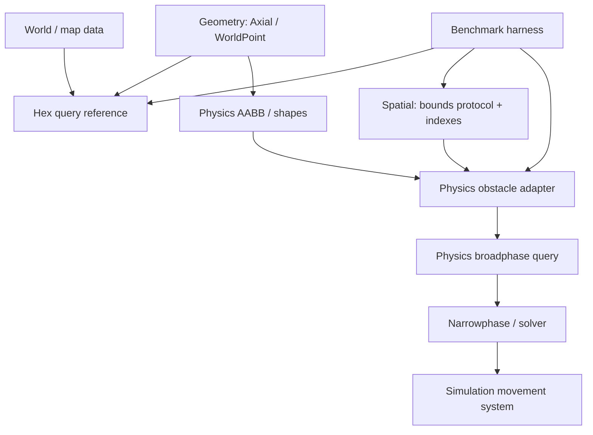

# Aşama 8 — Mekânsal İndeksleme ve Performans Karşılaştırması
> **Belge türü:** Ayrıntılı teknik mimari planı  
> **Proje:** Eldoria — Hex World Laboratory  
> **Depo:** `trippes/RPG_KAYNAK_YONETIMI`  
> **Çalışma dalı:** `experiment/hex-world-laboratory`  
> **Durum:** KULLANICI TARAFINDAN ONAYLANDI — TEKNİK PLAN UYGULANDI; OTOMATİK DOĞRULAMA TAMAM, GÖRSEL KABUL BEKLENİYOR  
> **Hazırlanma tarihi:** 17 Kasım 2026  
> **Genel plan:** [PHASE-08-GENERAL-PLAN.md](PHASE-08-GENERAL-PLAN.md)  
> **Planın hazırlandığı HEAD:** `81ea0ceb75bf773e32cea48a9da141fdc554a834`

---

## 1. Teknik karar özeti

Aşama 8'de tek bir indeksleme algoritması peşinen standartlaştırılmayacaktır. Üç ayrı sorgu problemi ve çözüm sınıfı birbirinden ayrılacaktır:

1. **Hex topoloji sorgusu:** Bir axial koordinatın belirli hex adım yarıçapındaki hücrelerini bulma. Mevcut `hex_neighbors()` ve `hex_distance()` fonksiyonları referans alınır. Kare tabanlı indeks, hex komşuluk kuralının yerine geçirilmez.
2. **Fiziksel AABB aday sorgusu:** Mevcut `physics.broadphase.gather_candidates()` fonksiyonunun yaptığı doğrusal engel taraması referans alınır. Uniform spatial hash/grid ve quadtree yaklaşımları bu sorgu için karşılaştırılır.
3. **Dinamik indeks güncellemesi:** Ekleme, kaldırma ve taşıma işlemlerinin sorgu maliyetiyle birlikte ölçülmesi. İndeksin güncelliği ve doğruluğu performans kadar önemlidir.

Önerilen deney adayları:
- Linear AABB taraması — değişmeden korunacak referans.
- Uniform spatial hash/grid — sınırsız/seyrek dünya koordinatlarında ana deney adayı.
- Quadtree — kare bölümlere ayırma deney adayı; sabit kök sınırı olan benchmark alanında değerlendirilecek.

**Karar kapısı:** Uniform grid veya quadtree varsayılan sistem hâline ancak doğruluk kapılarını geçip gerçek sorgu profillerinde toplam maliyet bakımından anlamlı fayda gösterirse getirilebilir. Sonuçlar fayda göstermiyorsa mevcut doğrusal tarama korunur.

## 2. Depo incelemesinden doğrulanan mevcut durum

Plan, laboratuvar dalındaki kaynak ve test ağaçları incelenerek hazırlanmıştır.

### 2.1 Geometri

| Dosya | Mevcut sorumluluk | Aşama 8 ilişkisi |
|---|---|---|
| `geometry/coordinates.py` | `AxialCoord`, `CubeCoord`, `WorldPoint` değer nesneleri | Hex ve sürekli dünya koordinatları |
| `geometry/neighbors.py` | Altı axial komşu yönü ve `hex_neighbors()` | Hex topoloji referansı |
| `geometry/distance.py` | `hex_distance()` | Hex adım uzaklığı |
| `geometry/layout.py` | `HexLayout`, orientation, radius ve origin | Dünya ölçeği ve hex yerleşimi |
| `geometry/transforms.py` | Axial/world dönüşümleri | İki koordinat alanı arasındaki sınır |

### 2.2 Fizik ve broadphase

| Dosya | Mevcut sorumluluk | Aşama 8 ilişkisi |
|---|---|---|
| `physics/broadphase.py` | `AABB`, `gather_candidates()` | Doğrusal referans sorgu |
| `physics/obstacle.py` | Immutable `ObstacleDefinition`, `world_shape()` | İndekslenecek statik engel |
| `physics/continuous.py` | Süpürülmüş circle hareketi, her impact turunda aday sorgusu | İndeks entegrasyon noktası |
| `physics/solver.py` | Kinematic çözüm, swept bounds ve depenetration | İndeks entegrasyon noktası |
| `physics/narrowphase.py` | Kesin şekil/temas kontrolü | Değişmeden kalacak nihai karar katmanı |
| `simulation/collision_aware_movement_system.py` | Hareket tick'i ve collision çözümünün orkestrasyonu | İndeksin isteğe bağlı tüketicisi |

Mevcut `gather_candidates()`, engel listesini tuple'a dönüştürür, her engelin dünya şekli için AABB hesaplar, sorgu AABB'siyle kesişimi kontrol eder ve sonucu obstacle ID'ye göre sıralar. Bu davranış doğruluk referansı olarak korunacaktır.

`resolve_kinematic_motion()` başlangıç swept bounds için broadphase çağırır; `resolve_continuous_motion()` da hareketin her impact adımında yeni swept bounds için aday toplar. İndeksin sorgu başına tekrar tekrar kurulması bu maliyet sorununu çözmeyecektir. İndeks, senaryo/harita ömrü boyunca yeniden kullanılabilen bir nesne olmalıdır.

### 2.3 Spatial paketi ve test altyapısı

- `src/hex_world_lab/spatial/` şu anda yalnızca `.gitkeep` içerir; indeks API'si mevcut değildir.
- `tests/unit/test_physics_broadphase.py`, AABB üretimi, inclusive sınır kesişimi, kararlı ID sırası ve broadphase false-positive davranışını doğrular.
- `tests/unit/test_physics_continuous.py`, `tests/unit/test_physics_solver.py` ve hareket entegrasyon testleri mevcut fizik davranışını korumak için regresyon tabanıdır.
- Benchmark klasöründe hareket/çarpışma ve render görünürlüğü ölçüm betikleri vardır. Aşama 8 için ayrı, tekrarlanabilir indeks benchmark'ları eklenecektir.

Bu plan, mevcut dosyaların güncel sorumluluklarını temel alır. Uygulama öncesi dosya SHA'ları ve güncel HEAD yeniden kontrol edilecektir.

## 3. Mimari yerleşim ve bağımlılık kuralları

### 3.1 Katman sorumlulukları

| Katman | Sorumluluk | Yapmaması gereken |
|---|---|---|
| Geometry | Axial/World koordinatları, hex topolojisi ve temel geometrik değerler | İndeks saklamak veya nesne yaşam döngüsü yönetmek |
| Spatial | Bounds tabanlı indeksleme, ekleme/güncelleme/kaldırma ve aday ID sorgusu | Physics kararı, World state mutasyonu, Pygame kullanımı |
| Physics | Obstacle ile indeks kayıtlarını eşlemek; adayları narrowphase'e aktarmak | İndeks algoritmasının içine fizik kurallarını gömmek |
| World | Harita ve hücre verisinin authoritative sahibi | Spatial index iç yapılarını doğrudan yönetmek |
| Simulation | Tick sırasında uygun sorgu sağlayıcısını kullanmak | İndeksin iç bucket/node yapılarını bilmek |
| Benchmarks | Aynı veride algoritmaları ölçmek | Oyun frame loop'una benchmark kodu eklemek |

### 3.2 Bağımlılık yönü

Kurallar:
- `spatial` paketi `physics`, `world`, `simulation`, `pygame` veya `camera` import etmeyecektir.
- `spatial` paketi bounds nesnesini yapısal bir protokol üzerinden kullanacaktır; böylece `physics.AABB` tipine bağımlı olmayacaktır.
- Physics, generic Spatial API'yi kullanabilir; Spatial, ObstacleDefinition veya collider shape tiplerini bilmez.
- Geometry, Spatial indeks yaşam döngüsünü yönetmez.
- Kamera ve ekran koordinatları hiçbir indeks API'sine girmez.
- Broadphase sonucu kesin çarpışma değildir. Narrowphase ve solver mevcut karar otoritesi olarak kalır.

## 4. Veri sözleşmeleri

Aşağıdaki sözleşmeler uygulama için önerilen API taslağıdır. İsimler ve alanlar teknik planın onayıyla sabitlenecek; uygulamada mevcut Python sürümü ve kod stiliyle uyumlu hâle getirilecektir.

### 4.1 Bounds protokolü

Spatial katmanının sorgu ve kayıt için ihtiyaç duyduğu minimum alanlar:
- `min_x`
- `min_y`
- `max_x`
- `max_y`

Bu alanlar sonlu sayısal değerler olmalı ve minimumlar maksimumları aşmamalıdır. Spatial katmanı `physics.AABB` sınıfını import etmeyecektir. Mevcut `AABB` bu protokolü yapısal olarak karşılar.

AABB'nin mevcut inclusive `intersects()` davranışı korunur: kenar veya köşe teması aday olarak tutulur. Böylece indeks sınırda temas edebilecek bir engeli yanlışlıkla elemez.

### 4.2 SpatialEntry

Önerilen immutable kayıt:
- `item_id: str` — indeks içinde benzersiz, boş olmayan kimlik.
- `bounds: Bounds2D` — dünya koordinatındaki AABB.

Kayıt collider türü, World nesnesi, render sprite'ı veya domain nesnesi saklamaz. Spatial indeks yalnızca kimlik ve sınır bilgisi tutar.

### 4.3 SpatialIndex protokolü

Önerilen operasyonlar:
- `insert(entry)` — yeni kimlik ekler; aynı kimlik zaten varsa açık bir hata üretir.
- `update(entry)` — mevcut kaydın bounds bilgisini değiştirir; bilinmeyen kimlik için açık hata üretir.
- `remove(item_id)` — kayıt kaldırır; bulunmayan kimlik için davranış tutarlı ve belgeli olur.
- `query(bounds) -> tuple[str, ...]` — bounds ile kesişen kayıtların benzersiz ID'lerini döndürür.
- `clear()` — tüm kayıtları temizler.
- `__len__()` veya eşdeğer kayıt sayısı özelliği — benchmark ve teşhis için.

Tüm uygulamalar aynı sözleşmeyi izler. Query çıktısı:
- Yinelenen ID içermez.
- Deterministik sıralanır.
- Inclusive AABB kesişim koşulunu uygular.
- Sadece aday bulma işini yapar; kesin çarpışma sonucu döndürmez.

### 4.4 ObstacleSpatialIndex adaptörü

Generic indeks ile Physics arasındaki eşleme Physics tarafında kalacaktır.

Önerilen adaptör sorumlulukları:
- `obstacle_id -> ObstacleDefinition` eşlemesini tutmak.
- `ObstacleDefinition.world_shape()` ve mevcut `AABB.from_shape()` üzerinden kayıt bounds'unu hesaplamak.
- Ekleme/güncelleme/kaldırma işlemlerini generic SpatialIndex'e iletmek.
- Sorgu ID'lerini obstacle nesnelerine dönüştürmek.
- Sonuçları obstacle ID'ye göre kararlı sırada döndürmek.
- MapId tutarlılığını korumak; farklı haritalara ait engelleri aynı map-scoped indekste karıştırmamak.

Bir obstacle güncellenirken yeni bounds önce doğrulanır; ardından eski hücre/node kayıtları kaldırılıp yeni kayıt eklenir. Hata durumunda indeks ve obstacle lookup tablosu yarım güncellenmiş bırakılmaz.

## 5. Karşılaştırılacak algoritmalar

### 5.1 Referans A — Linear AABB scan

Mevcut `gather_candidates(query_bounds, obstacles)` değişmeden korunur.

Ölçüm:
- N obstacle için tam tarama maliyeti.
- Her sorguda `world_shape()` ve AABB üretim maliyeti.
- Sonuç sıralama maliyeti.
- Küçük listelerde indeks kurulum/güncelleme overhead'ine karşı performansı.

Bu yöntem yalnızca baseline değildir; küçük sahnelerde en iyi varsayılan olarak kalabilir.

### 5.2 Aday B — Uniform spatial hash/grid

Veri yapısı:
- `dict[(cell_x, cell_y), set[item_id]]` sparse bucket haritası.
- `dict[item_id, SpatialEntry]` kayıt tablosu.
- Yapılandırılabilir, pozitif ve sonlu `cell_size`.

Kayıt ekleme:
1. Bounds'un kapsadığı minimum ve maksimum grid koordinatları `floor(world / cell_size)` ile hesaplanır.
2. Kayıt, AABB'sinin kestiği tüm bucket'lara eklenir.
3. Entry tablosuna tek kayıt konur.

Sorgu:
1. Query bounds'un kapsadığı bucket koordinatları hesaplanır.
2. İlgili bucket'lardaki ID'ler bir kümede birleştirilir.
3. ID'ler kayıt tablosundan çözülür.
4. Gerçek AABB kesişimi tekrar kontrol edilir.
5. Benzersiz ID'ler deterministik sırayla döndürülür.

Güncelleme:
- Eski bounds'un bucket referansları kaldırılır.
- Yeni bounds'un bucket referansları eklenir.
- Boş bucket'lar sözlükten silinir.
- Taşıma işlemi tek bir update operasyonu olarak dışarı açılır.

Sınır kuralları:
- Negatif koordinatlar için dilimleme/truncation değil matematiksel floor kullanılır.
- AABB'nin maksimum sınırı da kapsama hesabına dahildir. Kenar temasını korumak için bucket aralığı inclusive ele alınır.
- Birden çok bucket'tan gelen aynı ID tek kez döner.
- Çok büyük bounds çok sayıda bucket kaplayabilir; bu durum bellek ve ekleme maliyetinde ölçülür.
- Sonsuz dünya koordinatları için sabit root sınırı gerekmez.

Ölçülecek grid hücre boyutları, hex layout radius'una ve engel boyut dağılımına göre birden fazla profilde denenir. Tek bir hücre boyutu varsayılan olarak kabul edilmez.

### 5.3 Aday C — Quadtree

Quadtree, kare alt bölümlere ayırma yaklaşımının deneysel karşılığıdır.

Önerilen başlangıç sözleşmesi:
- Sabit ve sonlu `root_bounds`.
- Yapılandırılabilir `capacity` ve `max_depth`.
- Node başına bounds ve child node'lar.
- Her kayıt tek bir node'da tutulur.
- Bir AABB birden fazla child alanına taşıyorsa üst node'da tutulur; kayıt child'lara kopyalanmaz.

Sorgu:
- Query bounds ile kesişmeyen node'lar atlanır.
- Kesişen node'lardaki kayıtlar kontrol edilir.
- Sonuçlar benzersiz ve ID sıralı döndürülür.

Güncelleme:
- Kayıt önce mevcut node'dan çıkarılır.
- Yeni bounds root alanı içinde ise uygun node'a yeniden yerleştirilir.
- Root dışına taşma sessizce yok sayılmaz; açık hata veya yeniden kurulum politikası uygulanır.
- Root genişletme maliyeti ayrıca ölçülür; ilk prototipte otomatik root genişletme zorunlu değildir.

Quadtree sabit dünya alanı ve dengesiz dağılımda yararlı olabilir; fakat root yönetimi, node overhead'i ve sık hareket eden nesnelerde update maliyeti dezavantaj olabilir. Bu nedenle deneysel adaydır; önceden üretim varsayılanı sayılmaz.

### 5.4 Hex topoloji sorgusu — ayrı referans

Hex sorgusu kare indeksine dönüştürülmeyecektir.

İki yöntem ölçülür:
1. Haritadaki tüm mevcut hücreleri dolaşarak `hex_distance(center, cell) <= radius` koşulunu kontrol eden brute-force referans.
2. Axial koordinat uzayında yarıçapın kapsadığı q/r aralığını doğrudan üreten, her aday koordinat için map cell lookup yapan yöntem.

İkinci yöntemde aday koordinatlar cube/axial mesafe koşuluyla sınırlandırılır. Haritada bulunmayan koordinatlar sonuç listesine eklenmez. Radius sıfır, tek hücre, harita kenarı, negatif q/r ve seyrek harita test edilir.

Mevcut `hex_neighbors()` bir adımlık altı komşu üretir ve korunur. Gerekirse yarıçaplı disk üretimi yalnızca Geometry katmanında saf bir yardımcı fonksiyon olarak tasarlanabilir; indeks sınıfı olarak sunulmaz.

## 6. Physics entegrasyon tasarımı

### 6.1 Mevcut davranışın korunması

Mevcut public çağrılar geriye dönük çalışmaya devam etmelidir:
- `gather_candidates(query_bounds, obstacles)`
- `resolve_kinematic_motion(..., obstacles)`
- `resolve_continuous_motion(..., obstacles)`
- `CollisionAwareMovementSystem(..., obstacles)`

İndeks kullanımı opsiyonel olacaktır. İndeks sağlanmadığında mevcut linear yol çalışır. Böylece eski testler, demo ve çağıran kodlar bir anda indeks nesnesi oluşturmaya zorlanmaz.

### 6.2 Yeni indexed sorgu yolu

Physics adaptörü üzerinden indeksli sorgu sağlanır. Solver ve continuous collision katmanları generic grid/quadtree detayını bilmez; yalnızca obstacle sorgu sağlayıcısının query sözleşmesini kullanır.

Önerilen entegrasyon:
- `physics/broadphase.py`: `AABB` ve mevcut `gather_candidates()` korunur; `ObstacleSpatialIndex` adaptörü veya ayrı `physics/spatial_adapter.py` tanımlanır.
- `physics/solver.py`: opsiyonel obstacle query provider ile ilk swept bounds adaylarını alır. Provider yoksa mevcut `gather_candidates()` kullanılır.
- `physics/continuous.py`: ilk depenetration ve her sweep impact adımında aynı provider sorgulanır. Her yeni swept bounds için indeks tekrar sorgulanır.
- `simulation/collision_aware_movement_system.py`: opsiyonel indeks/provider enjeksiyonu sunar; movement tick, indeks iç yapısını bilmez.

İndeks nesnesi movement system tarafından her tick yeniden oluşturulmayacaktır. Harita/obstacle snapshot'ı değiştiğinde veya obstacle taşındığında güncellenir.

### 6.3 Tutarlılık ve sahiplik

- ObstacleDefinition immutable kalır.
- ObstacleSpatialIndex map-scoped olur.
- Aynı obstacle ID iki kez eklenemez.
- Update, ID'yi değiştirmez; bounds ve obstacle snapshot'ını yeniler.
- Remove sonrası ID hiçbir bucket/node query sonucunda görünmez.
- Map unload/remove yaşam döngüsüyle indeksin temizlenmesi entegrasyon testinde ele alınır; World runtime'ın private sözlüklerine erişilmez.
- Index query sırasında kayıt tablosu ve bucket/node yapıları aynı mantıksal snapshot'ı temsil eder.
- Aynı indeksin eşzamanlı thread güncellemeleri bu aşamanın kapsamı değildir; thread-safety taahhüdü verilmez.

### 6.4 Broadphase ve narrowphase sınırı

Spatial index yalnızca swept/query AABB ile kesişebilecek obstacle adaylarını getirir. AABB false-positive sonuçları beklenen davranıştır. Her aday mevcut `collide_shapes()`, `sweep_circle_polygon()` veya ilgili solver tarafından kesin geometri kontrolüne tabi tutulur.

**False negative kabul edilemez.** İndeksin bir engeli atlaması karakterin duvardan geçmesine veya başlangıç penetrasyonunun çözülememesine neden olabilir.

## 7. Dosya değişiklik planı

Dosya listesi uygulama hedefidir; mevcut API'yi korumak için küçük uyarlamalar yapılabilir. Uygulama öncesi HEAD ve her hedefin SHA'sı yeniden kontrol edilecektir.

| Dosya | İşlem | Sorumluluk |
|---|---|---|
| `src/hex_world_lab/spatial/__init__.py` | Yeni | Spatial public API dışa aktarımı |
| `src/hex_world_lab/spatial/protocols.py` | Yeni | Bounds2D ve SpatialIndex protokol sözleşmeleri |
| `src/hex_world_lab/spatial/entry.py` | Yeni | Immutable SpatialEntry |
| `src/hex_world_lab/spatial/grid.py` | Yeni | Uniform spatial hash/grid |
| `src/hex_world_lab/spatial/quadtree.py` | Yeni | Deneysel quadtree |
| `src/hex_world_lab/spatial/linear.py` | Gerekirse yeni | Benchmark için ortak linear referans adaptörü; mevcut Physics baseline'ı kopyalamadan |
| `src/hex_world_lab/physics/broadphase.py` | Genişlet | ObstacleSpatialIndex adaptörü veya provider bağlantısı; eski API korunur |
| `src/hex_world_lab/physics/solver.py` | Dar kapsamlı güncelle | İsteğe bağlı indexed candidate provider |
| `src/hex_world_lab/physics/continuous.py` | Dar kapsamlı güncelle | Her swept query için provider kullanımı |
| `src/hex_world_lab/simulation/collision_aware_movement_system.py` | Dar kapsamlı güncelle | Opsiyonel provider enjeksiyonu ve yaşam döngüsü |
| `src/hex_world_lab/geometry/neighbors.py` | Gerekirse genişlet | Yarıçaplı axial disk yardımcı sorgusu; mevcut komşu API'si korunur |
| `tests/unit/test_spatial_protocols.py` | Yeni | Bounds ve API sözleşmesi |
| `tests/unit/test_spatial_grid.py` | Yeni | Grid insert/update/remove/query ve sınırlar |
| `tests/unit/test_spatial_quadtree.py` | Yeni | Quadtree bölünme, root sınırı ve sorgu |
| `tests/unit/test_spatial_differential.py` | Yeni | Grid/quadtree sonuçlarının brute-force referansla eşitliği |
| `tests/unit/test_physics_obstacle_index.py` | Yeni | Obstacle adaptörü, map scope ve güncellik |
| `tests/unit/test_physics_broadphase.py` | Genişlet | Mevcut linear API geriye dönük uyumu |
| `tests/unit/test_physics_solver.py` | Genişlet | İndeksli/indekssiz çözüm eşdeğerliği |
| `tests/unit/test_physics_continuous.py` | Genişlet | Sweep adımlarında indeks sorgusu ve eşdeğerlik |
| `tests/unit/test_collision_aware_movement_system.py` | Genişlet | Provider enjeksiyonu ve tick davranışı |
| `tests/integration/test_spatial_physics_integration.py` | Yeni | World/Physics/Spatial entegrasyonu |
| `benchmarks/benchmark_spatial_index.py` | Yeni | Linear/grid/quadtree benchmark |
| `benchmarks/benchmark_hex_neighborhood.py` | Yeni | Hex full-scan ve axial aday sorgusu |
| `reports/PHASE-08-IMPLEMENTATION-VALIDATION-REPORT.md` | Aşama sonunda yeni | Ölçüm ve doğrulama sonuçları |
| `reports/PHASE-08-CLOSURE-REPORT.md` | Aşama sonunda yeni | Kabul ve kapanış |

Not: Unit test dosyalarının bir kısmı mevcut repository düzeninde zaten varsa yeni dosya açılmayacak; mevcut dosya genişletilecektir. Yukarıdaki liste hedef sorumlulukları tanımlar.

## 8. Test mimarisi ve doğruluk kanıtı

### 8.1 Differential testing

Her benchmark veri kümesi için aynı `query_bounds` şu yöntemlere verilir:
- Linear reference.
- Uniform grid.
- Quadtree.

Her yöntemin sonuç ID kümesi linear referansla birebir eşleşmelidir. İndeks yalnızca broadphase adaylarını döndürdüğü için bu aşamada sonuç eşitliği beklenir; yalnızca gerçek çarpışanları döndürmesi beklenmez.

Randomized differential testlerde sabit seed kullanılır. Üretilen AABB'ler:
- Pozitif ve negatif koordinatlarda,
- Tam bucket sınırlarında,
- Tek hücreden küçük ve çok hücreyi kapsayan boyutlarda,
- Birbirinin içine giren ve sadece kenardan/köşeden temas eden durumlarda,
- Çok büyük ve çok küçük değerlerde
oluşturulur.

### 8.2 Grid özel testleri

- Negatif koordinatta floor davranışı.
- AABB maksimum sınırının bucket'a dahil edilmesi.
- Çoklu bucket kaydında tek ID dönmesi.
- Bir kaydın birden çok bucket'tan eksiksiz silinmesi.
- Update sonrası eski bölgede sonuç kalmaması.
- Aynı ID ile ikinci insert'in reddedilmesi.
- Boş bucket temizliği.
- Büyük AABB'nin bucket sayısı ve bellek etkisi.
- Sıfır/negatif/NaN/sonsuz cell_size reddi.

### 8.3 Quadtree özel testleri

- Root bounds dışında kayıt reddi.
- Root kenarına tam temas.
- Node kapasitesinde bölünme.
- Split çizgisine değen veya birden fazla child'a taşan AABB'nin üst node'da tutulması.
- Derinlik sınırında sonlanma.
- Update/remove sonrasında boş node davranışı.
- Query sonucu linear referansla aynı.
- Dengesiz kümelenmede derinlik ve node sayısı ölçümü.

### 8.4 Physics entegrasyon testleri

Aynı actor başlangıç state'i, body, obstacle seti ve intent dizisiyle iki kez çalıştırılır:
1. Linear candidate path.
2. Indexed candidate path.

Karşılaştırılacak çıktılar:
- Final world position.
- Final velocity.
- Contact ID ve sıralaması.
- Sweep impact ID ve sıralaması.
- Iteration sayısı.
- Unresolved penetration.
- Tick numarası ve hata davranışı.

İndeksli yolun fiziksel sonuçları referansla aynı olmalıdır. AABB false-positive'ları narrowphase elemelidir. Başlangıç penetrasyonu ve çoklu duvar köşesi testleri özellikle kapsanır.

### 8.5 Hex sorgu testleri

- Radius 0 yalnızca merkez hücreyi üretir.
- Radius 1 mevcut altı komşuyu ve merkezi kapsar.
- Daha büyük radius için aday kümesi brute-force `hex_distance` sonucu ile eşleşir.
- Flat-top/pointy-top farkı axial komşuluk sayısını değiştirmez.
- Negatif q/r, harita kenarı ve eksik hücreler doğru ele alınır.
- Aynı merkez/radius aynı deterministik sırayı verir.

### 8.6 Regresyon

- Mevcut `gather_candidates()` çağrıları ve dönüş sırası korunur.
- Physics narrowphase ve solver kararları değişmez.
- Collision-aware movement tick sözleşmesi korunur.
- Mevcut kamera, render, world persistence ve input davranışları etkilenmez.
- Aşama 0–7 test paketi eksiksiz çalıştırılır.

## 9. Benchmark protokolü

### 9.1 Veri profilleri

Başlangıç senaryo ölçekleri:
- 100 obstacle — küçük.
- 1.000 obstacle — orta.
- 10.000 obstacle — büyük.
- 50.000 obstacle — stres.

Bunlar başlangıç deney ölçekleridir; hedef oyun haritası boyutu, performans garantisi veya kabul eşiği değildir. Laboratuvar ortamı ve bellek sınırları nedeniyle ayarlanırsa raporda gerekçesi yazılır.

Dağılım profilleri:
- Uniform: dünya alanına dengeli dağılım.
- Clustered: birkaç bölgede kümelenmiş.
- Sparse: geniş alana seyrek dağılmış.
- Mixed-size: küçük ve büyük AABB'ler birlikte.

Hareket profilleri:
- Static: indeks sadece sorgulanır.
- Low churn: her batch'te küçük bir oran update edilir.
- High churn: her batch'te daha büyük bir oran taşınır.
- Insert/remove: yaşam döngüsü maliyeti ayrı ölçülür.

### 9.2 Sorgu profilleri

- Small query: tek/az sayıda grid hücresine denk gelen dar AABB.
- Medium query: birkaç hücreyi kesen AABB.
- Large query: çok sayıda bucket/node gezen geniş AABB.
- Edge query: bucket veya quadtree split çizgisine tam oturan sorgu.

Sorgu AABB'leri sabit seed ile üretilir. Her algoritma aynı kayıt ve sorgu dizisini kullanır.

### 9.3 Grid parametreleri

Grid cell size, dünya birimi üzerinden farklı ölçeklerde denenir. Başlangıç adayları obstacle AABB boyutlarının medyanı ve hex layout radius'u ile ilişkilendirilir. Nihai değerler benchmark sonuçları görülmeden sabitlenmez.

### 9.4 Quadtree parametreleri

Başlangıç deneme seti:
- Capacity: 4, 8, 16.
- Max depth: 6, 8, 10.
- Root bounds: aynı senaryo veri alanını kapsayan sabit kare.

Parametre sayısı benchmark süresini aşırı büyütürse önce küçük bir tarama yapılır, sonra en iyi iki konfigürasyon daha uzun tekrarlarla ölçülür.

### 9.5 Ölçülecek metrikler

| Metrik | Açıklama |
|---|---|
| Build time | İlk indeks oluşturma süresi |
| Query latency | Tek sorgu süresi; median ve p95 |
| Total query time | Sabit sorgu dizisinin toplam süresi |
| Candidate count | İndeksin döndürdüğü aday sayısı |
| Exact match count | Linear AABB sonucundaki gerçek aday sayısı |
| Update latency | Tek kaydın taşıma/güncelleme süresi |
| Insert/remove latency | Ekleme ve kaldırma süresi |
| Memory peak | Benchmark sırasında tracemalloc tepe bellek ölçümü |
| Bucket/node count | Yapısal maliyet göstergesi |
| Churn cost | Güncelleme + sorgu toplam maliyeti |
| Speedup | Aynı koşuldaki linear baseline'a oran |

Süreler için warm-up batch'leri ve birden çok ölçüm batch'i uygulanır. Python sürümü, platform, işlemci bilgisi, seed, veri profili, parametreler ve tekrar sayısı JSON raporuna yazılır. Benchmark CI'da smoke çalıştırılabilir; donanıma duyarlı süreler katı test eşiği yapılmaz.

### 9.6 Karar ölçütü

Yöntem yalnızca query latency'ye bakılarak seçilmez. Build + query + update maliyetinin gerçek kullanım oranına göre toplamı değerlendirilir.

- Statik engellerde build maliyeti seyrek ödenir; query maliyeti ağırlıklıdır.
- Hareketli nesnelerde update maliyeti daha sık ödenir.
- Çok geniş sorgularda linear tarama, indeks traversal'ından daha ucuz olabilir.
- Küçük obstacle setlerinde linear yöntem en iyi sonuç olabilir.

Bir indeksin kazancı, ölçüm gürültüsünü aşmıyorsa veya toplam maliyeti artırıyorsa varsayılan yapılmaz.

## 10. İş paketleri ve uygulama sırası

### 8.1 — Baseline ve sorgu sözleşmesi
- Mevcut broadphase/solver/continuous call graph'ini sabitle.
- Linear sonuçların deterministic olduğunu test et.
- Hex sorgusu ile AABB sorgusunu ayrı benchmark problemine dönüştür.
- Çıktı: baseline raporu ve kabul edilmiş API taslağı.

### 8.2 — Spatial generic sözleşmesi
- Bounds2D protokolü, SpatialEntry ve SpatialIndex protokolünü ekle.
- Pygame/Physics/World bağımsızlığını import-boundary testleriyle doğrula.
- Çıktı: generic API ve unit testler.

### 8.3 — Uniform grid prototipi
- Sparse bucket map, entry table, insert/update/remove/query.
- Negative coordinates ve inclusive sınır davranışını tamamla.
- Differential testleri geçir.
- Çıktı: çalışan grid prototipi.

### 8.4 — Quadtree prototipi
- Sabit root bounds, split, parent-held straddling entries ve query.
- Update/remove ve root dışı davranışını tamamla.
- Differential testleri geçir.
- Çıktı: çalışan quadtree prototipi.

### 8.5 — Physics obstacle adaptörü
- ObstacleDefinition ile SpatialEntry arasında dönüşüm.
- Map scope ve güncellik.
- Eski linear API'yi koruyarak opsiyonel indexed provider.
- Çıktı: adapter ve entegrasyon testleri.

### 8.6 — Hex sorgu benchmark'ı
- Full map scan ve axial aday üretimini aynı harita verisinde karşılaştır.
- Mevcut hex distance/neighbors davranışını koru.
- Çıktı: hex sorgu doğruluk ve performans raporu.

### 8.7 — Performans ve regresyon
- Tüm dağılım, sorgu, update ve bellek profillerini ölç.
- Linear/grid/quadtree kıyasını tamamla.
- Physics indexed/linear sonuç eşdeğerliğini doğrula.
- Çıktı: benchmark JSON ve karşılaştırma raporu.

### 8.8 — Mimari öneri ve kapanış
- Sonuçları ve ödünleşimleri açıkla.
- Üretim varsayılanı, hibrit seçim veya linear kalma önerisini gerekçelendir.
- Gerekirse Spatial ADR'sini hazırla.
- Kapanış raporu ve kullanıcı kabulü.
- Çıktı: onaylanmış mimari karar.

Her alt aşama kendi test kapısını geçmeden sonraki alt aşamaya geçilmez.

## 11. Kabul kriterleri

| No | Kriter | Doğrulama kanıtı |
|---|---|---|
| 1 | Linear AABB baseline korunur | Mevcut testler ve API uyumluluğu |
| 2 | Spatial katmanı Physics/World/Pygame bağımlılığı taşımaz | Import boundary testi |
| 3 | Grid sorguları linear sonuçla aynı ID kümesini üretir | Differential/property test |
| 4 | Quadtree sorguları linear sonuçla aynı ID kümesini üretir | Differential/property test |
| 5 | Negative ve sınır koordinatlarında aday kaybı yoktur | Özel sınır testleri |
| 6 | Insert/update/remove indeks tutarlılığını korur | Lifecycle testleri |
| 7 | Physics indexed ve linear çözüm aynı sonucu verir | Movement/solver/continuous integration testleri |
| 8 | Narrowphase nihai karar otoritesidir | False-positive testleri |
| 9 | Hex radius sorgusu brute-force ile eşleşir | Hex differential test |
| 10 | Build/query/update/memory ölçümleri raporlanır | Tekrarlanabilir benchmark JSON |
| 11 | Linux ve Windows kalite kontrolleri geçer | CI sonuçları |
| 12 | Aşama 0–7 davranışları korunur | Tam regresyon paketi |
| 13 | Varsayılan yöntem önerisi ölçümle gerekçelendirilir | Karşılaştırma raporu ve gerekirse ADR |
| 14 | Kapanış raporu ve kullanıcı kabulü tamamlanır | Closure report ve kullanıcı onayı |

Performans için önceden sabit bir yüzde hızlanma şartı koyulmaz. Bir indeksin varsayılan seçilmesi için ölçülebilir ve tekrar edilebilir toplam fayda göstermesi gerekir. Aksi durumda linear baseline'ı korumak başarılı ve kabul edilebilir sonuçtur.

## 12. Riskler ve teknik önlemler

| Risk | Etki | Önlem |
|---|---|---|
| Grid bucket sınırında false negative | Çarpışma kaçırma | Inclusive bucket aralığı ve differential test |
| Negatif koordinatta yanlış bucket | Yanlış aday kümesi | `floor` kullanımı ve negatif koordinat testleri |
| Büyük AABB çok fazla bucket kaplar | Bellek/update maliyeti | Mixed-size profil, maliyet raporu; gerekirse alternatif yaklaşım |
| Quadtree root dışı kayıt | Kayıt kaybı | Açık hata ve root lifecycle testi |
| Quadtree straddling nesne kopyalama | Duplicate ve bellek artışı | Kaydı tek parent node'da tutma |
| İndeks güncellemesi yarım kalır | Stale kayıt | Validate-first ve tek operasyonlu update |
| Her tick yeni indeks kurulması | Kazanç kaybı | Uzun ömürlü provider enjeksiyonu |
| Farklı map'lerin karışması | Yanlış fizik sorgusu | Map-scoped ObstacleSpatialIndex |
| İndeks broadphase'i narrowphase sanır | Hatalı collision | Physics sınır testleri |
| Küçük listede indeks overhead'i | Yavaşlama | Linear fallback/karşılaştırmalı karar |
| Benchmark gürültüsü | Yanlış algoritma seçimi | Sabit seed, warmup, tekrar, median/p95 |
| Spatial katmanın domain'e bağlanması | Mimari bağımlılık döngüsü | Bounds2D protokolü ve import testleri |

## 13. Kapsam dışı ve açık sınırlar

Aşama 8'de yapılmayacaklar:
- A*, Dijkstra veya başka pathfinding algoritması.
- Tıklanan hedefe karakter yürütme ve rota çizme.
- Hareket kararının, collision response'un veya narrowphase matematiğinin yeniden yazılması.
- NPC/Entity/Interaction sisteminin kurulması.
- World persistence formatının değiştirilmesi.
- Kamera, renderer veya görsel sanat zenginleştirmesi.
- Pygame veya Godot mimari geçişi.
- Ana oyun dalına veya `demo_eldoria` dalına entegrasyon.

Hex komşuluk sorgusu, pathfinding değildir. Bu aşamada yalnızca belirli bir hücrenin komşu/yarıçap adaylarını verimli ve doğru üretmek araştırılır; rota maliyeti veya hedefe ulaşma algoritması geliştirilmez.

## 14. Uygulama öncesi kontrol listesi

Kodlamaya başlamadan önce:
- [ ] Lab dalı HEAD SHA doğrulanır.
- [ ] Her değişecek kaynak dosyanın güncel SHA'sı alınır.
- [ ] Yeni dosya oluşturulacaksa mevcut olmadığı doğrulanır.
- [ ] Ana dal ve demo dalının HEAD değerleri salt okunur biçimde kaydedilir.
- [ ] Genel plan ve bu teknik planın kapsamı eşleştirilir.
- [ ] Kullanıcı teknik planı onaylar.

Her commit öncesi/sonrası:
- [ ] Yazma işlemi açıkça `experiment/hex-world-laboratory` dalına yönlendirilir.
- [ ] Güncellenen dosyada beklenen SHA kullanılır.
- [ ] Commit ve lab HEAD doğrulanır.
- [ ] `main` ve `demo_eldoria` değişmediği doğrulanır.
- [ ] Test ve benchmark sonuçları gerçek çalıştırma çıktısından raporlanır.

---

## 15. Onay kapısı

Bu belge kullanıcı tarafından 17 Kasım 2026 tarihinde onaylanan Aşama 8 uygulama sözleşmesidir. Alt aşamalar 8.1–8.8 uygulanmış ve otomatik doğrulamadan geçmiştir.

**Kullanıcı onayı beklenen kararlar:**
1. Linear AABB taramasının referans olarak korunması.
2. Uniform spatial hash/grid ve quadtree'nin karşılaştırılacak iki indeks prototipi olması.
3. Hex topoloji sorgusunun fiziksel AABB indeksinden ayrı ele alınması.
4. Spatial generic API + Physics obstacle adapter ayrımı.
5. İndeksli physics yolunun opsiyonel olması ve mevcut API'nin geriye dönük korunması.
6. Performans faydası kanıtlanmazsa linear yöntemin korunabilmesi.

**Uygulama durumu:** 8.1–8.8 tamamlandı. 729/729 test, Linux/Windows Core Quality ve benchmarklar başarılıdır.  
**Sonraki adım:** Kullanıcı PHASE-08-MANUAL-ACCEPTANCE-CHECKLIST.md listesini tamamlar; kabul sonrası kapanış raporu hazırlanır.
