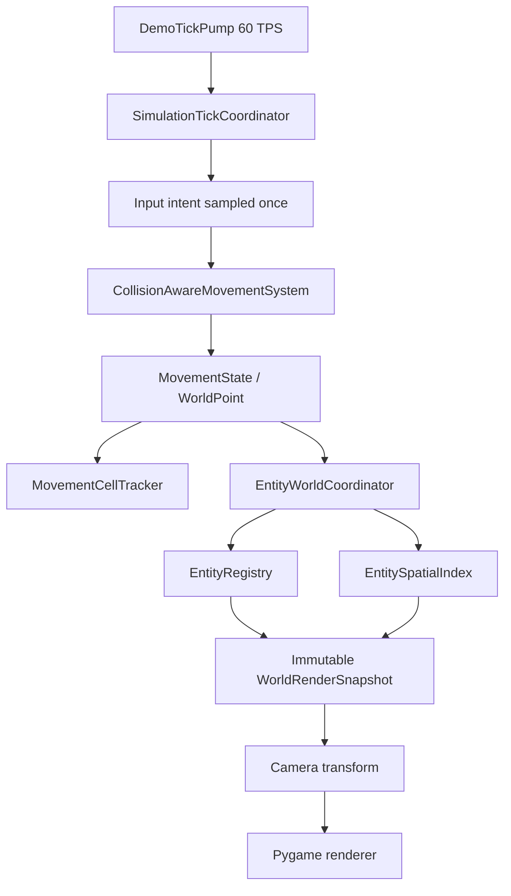
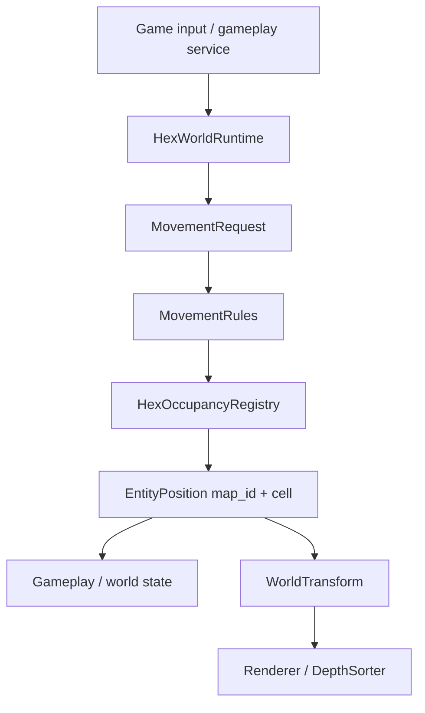
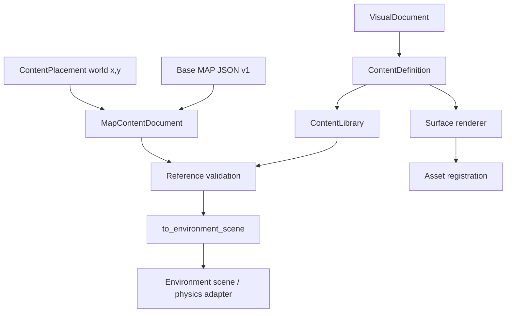
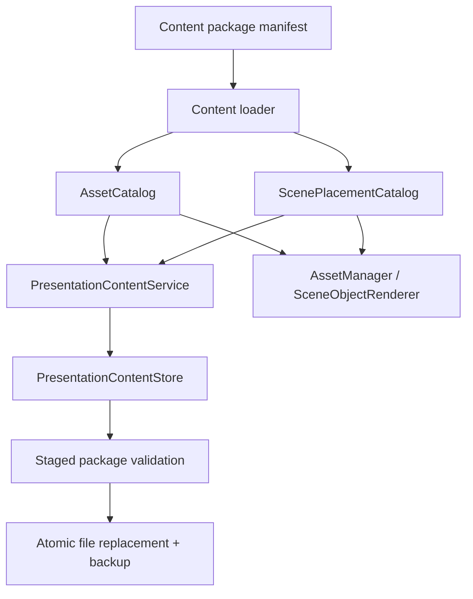

# Aşama 15.3 — Veri Sahipliği ve Akış Sözleşmesi

Tarih: 19 Kasım 2026. Amaç: Lab ve Main için producer, authoritative owner, consumer ve adapter sınırlarını belirlemek.

## 1. Laboratuvar veri sahipliği

| Veri | Üretici | Authoritative owner | Tüketici | Türetilmiş veri |
|---|---|---|---|---|
| Axial hücre adresi | Geometry conversion/map definition | HexMapDefinition ve map kimliği | World, cell tracker, interaction | WorldPoint merkez/polygon |
| Sürekli konum | Movement integrator/collision-aware movement | MovementState ve entity transform coordinator | Cell tracker, registry, snapshot | Axial hücre, AABB, screen point |
| Entity kaydı | Entity lifecycle işlemleri | EntityRegistry | Interaction, EntitySpatialIndex, snapshot | Spatial entries |
| Spatial index | Registry/map lifecycle ve transform sync | Authoritative değildir; rebuild edilebilir cache | Broadphase query | Candidate list |
| Tick state | SimulationTickCoordinator ve movement system | Tamamlanmış simulation tick | Entity sync, snapshot builder | Render snapshot |
| Camera | Input/frame update | Camera state | Renderer ve mouse transform | Screen coordinates |
| Render data | Snapshot builder | Immutable WorldRenderSnapshot | Pygame renderer | Surface/cache |
| Vector content | Authoring/import factory | ContentLibrary | MapContentDocument, renderer adapter | Pygame Surface |
| Map placement | Content domain API | MapContentDocument | Reference validator, environment adapter | Environment scene/physics shapes |
| JSON dosyası | Persistence codec/storage | Dosya sürümü; load sonrası domain model | Domain loader | Runtime objects |

## 2. Lab simülasyon tick akışı

Kurallar:
- DemoTickPump zamanlayıcıdır; domain state'i sahiplenmez.
- SimulationTickCoordinator alt adım sırasını ve aynı tick retry checkpoint'ini yönetir.
- Movement/physics tamamlanmış WorldPoint üretir.
- Cell tracker WorldPoint'ten axial hücre türetir; konumu hücre merkezine yuvarlamaz.
- Entity coordinator registry ve map-scoped spatial index'i eşitler.
- Snapshot ve camera sunum verisidir; simulation state'ini değiştiremez.

## 3. Ana oyun veri akışı

Ana oyunda hex runtime authoritative entity konumu EntityPosition(map_id, LocalHexPosition(q,r)) biçimindedir. HexWorldRuntime hareket isteğini MovementRules ve HexOccupancyRegistry üzerinden doğrular; başarılı hücre geçişi occupancy ve entity kayıtlarını günceller. Pathfinding ve move_toward discrete hücre modeline aittir.

Main Position(x,y) genel 2D değer tipidir; hex runtime entity konumunun yerine geçmez.

## 4. İçerik veri akışı

Main'in mevcut ayrı hattı:

İki hat aynı schema veya storage değildir. A16 öncesi içerik otoritesi kararı gerekir.

## 5. Coordinate conversion contract

| Source | Target | Dönüşüm | Kayıp/varsayım |
|---|---|---|---|
| Lab WorldPoint | Lab AxialCoord | world_to_axial(point, layout, previous_cell) | Önceki hücre yalnızca sınır tie-break |
| Lab AxialCoord | Lab WorldPoint | axial_to_world(coord, layout) | Layout/origin/radius gerekir |
| Main EntityPosition | Main axial cell | map_id + LocalHexPosition | Sürekli alt-hücre konumu içermez |
| Main LocalHexPosition | Main world pixel | WorldTransform.axial_to_world(HexCoord) | Hex size ve geometri yönelimi gerekir |
| Main world pixel | Screen pixel | WorldTransform.world_to_screen | Camera offset, viewport center, zoom |
| Lab WorldPoint | Main world pixel | Henüz tanımlı değil | Birim ölçeği, Y ekseni, origin ve map transform açıkça kararlaştırılmalı |

Dönüşüm fonksiyonları WorldPoint, Position, LocalHexPosition veya ScreenPosition tiplerini sessizce cast etmemelidir.

## 6. ID ve yaşam döngüsü

- Lab entity kimliği, world/map kimliği ve map-local cell ayrı alanlardır.
- Main EntityPosition map_id taşır; HexWorldRuntime entity registry ve occupancy'yi yönetir.
- Content content_id tekrar kullanılabilir tanımı, instance_id tek harita yerleşimini tanımlar.
- Main asset_id tekrar kullanılabilir raster varlığı; object_id tek placement kaydıdır.
- Lab instance_id ile Main object_id otomatik eşit kabul edilmez; adaptör ID eşleme tablosu üretmelidir.

## 7. Hata davranışı

- Eksik map/cell, unresolved content reference, duplicate ID ve unsupported schema version açık hata olarak kalır.
- Spatial index kaynak veri değildir; bozulursa authoritative registry/map verisinden yeniden oluşturulur.
- Persistence staged validation başarısızsa canlı package dosyaları değişmemelidir.
- Adapter hatası kaynak domain modelini kısmi güncellememeli; dönüşüm önce doğrulanmalı, commit sonra yapılmalıdır.
