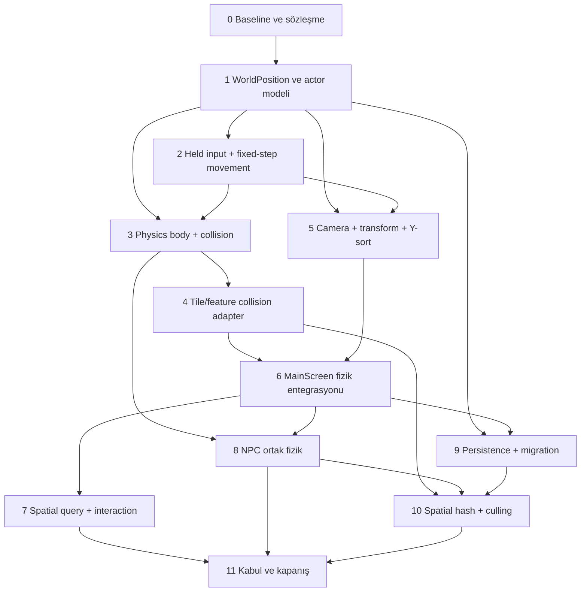

# ELDORIA RPG — SERBEST HAREKET SİSTEMİ
## Kapsamlı Teknik Denetim ve Master Uygulama Planı V2

**Proje:** Eldoria – Kaynak Yönetimi RPG  
**Depo:** `trippes/RPG_KAYNAK_YONETIMI`  
**Denetlenen dal:** `demo_eldoria`  
**Denetim başlangıç HEAD'i:** `5cc0162f4e0b8b6bc330b363da49c16e0f02150d`  
**Rapor:** `reports/serbest-hareket-sistemi-master-uygulama-plani-v2.md`  
**Tarih:** 14 Kasım 2026  
**Durum:** Teknik denetim tamamlandı; uygulama başlamadı.

---

# 1. Yönetici özeti

Eldoria'da tek bir hareket sistemi yoktur. Denetlenen dalda birbirinden ayrılmış iki yerel oynanış yolu bulunuyor:

1. **Mevcut ana kare harita:** `game_ui/screens/main_screen.py` içindeki `MainScreen`. Oyuncu konumu kare tile koordinatları olarak kullanılır; klavye hareketi tek tile adımlıdır. Harita engelleri tile kümeleri üzerinden kontrol edilir. Her başarılı adım `GameplayService.advance_by(1)` çağrısıyla canonical simülasyon zamanını da ilerletir.
2. **Altıgen dünya geliştirme köprüsü:** `game_ui/hex_world_view.py` içindeki `HexWorldView`, `application/hex_world_runtime.py` ile çalışır. Mantıksal konum axial hücredir. Hareket runtime'da anında uygulanır; Pygame tarafında `_movement_path` ve `_movement_elapsed` ile yalnızca görsel interpolasyon gösterilir. Bu, serbest fiziksel hareket değildir.

Önemli sonuç: Hedeflenen serbest hareket dönüşümü yalnızca bir vektör hesabı eklemekten ibaret değildir. Önce hangi yerel dünya yüzeyinin oyuncu için kalıcı ve yetkili olacağı kararlaştırılmalı; ardından fiziksel konum, mantıksal hücre, çarpışma geometrisi, input durumu, kamera, etkileşim ve kayıt sınırları tek sözleşmede birleştirilmelidir.

Mevcut altyapıda önemli yapı taşları korunabilir:
- `core.domain.spatial.Position` zaten sonlu int/float X/Y kabul ediyor ve JSON'a sayısal değer yazıyor.
- `HexWorldRuntime`, axial dünya kuralları, occupancy, A* ve atomik harita geçişi için kullanılabilir.
- `WorldTransform`, world/screen dönüşümü ve zoom için yararlı bir sunum adaptörü sunuyor.
- `HexCamera`, zaman tabanlı yumuşak takip ve harita sınırı clamp davranışına sahip.
- `SceneObjectPlacement` / `SceneObject`, world-pixel collision AABB, anchor, footprint ve depth metadata sözleşmelerine sahip.
- Actor snapshot ve üst save envelope zaten konum verisini taşıyor; ancak restore hattı fiziksel kesirleri kaybediyor.

**V2'nin ana mimari kararı:** Fiziksel yerel hareket, UI kodunun içine veya canonical simulation scheduler'a gömülmemelidir. Pygame yalnızca input örnekler ve sonucu çizer. Uygulama katmanı hareket oturumunu yönetir. Pygame'den bağımsız fizik/çarpışma modülü geometriyi çözer. Hücresel/altıgen dünya mantığı, fiziksel konumdan türetilen mantıksal sorgu ve harita geçiş adaptörleriyle korunur.

---

# 2. Denetim yöntemi, kapsam ve sınırlar

## 2.1 Dal ve sürüm doğrulaması

GitHub repository metadata'sı `trippes/RPG_KAYNAK_YONETIMI` deposunu ve varsayılan dalın `main` olduğunu doğruladı. `demo_eldoria` dalı ayrıca branch araması ve Git ref endpoint'i ile doğrulandı.

Denetim anında `refs/heads/demo_eldoria` şu commit'i gösteriyordu:

```text
5cc0162f4e0b8b6bc330b363da49c16e0f02150d
docs(reports): add free movement architecture plan to demo branch
```

Bu commit'in ebeveyni `a8aed387cb71e96037c0d67bdc000f77c8314c4e` idi. Dal HEAD'i denetim başlangıç referansıdır; rapor oluşturulurken branch head yeniden kontrol edilmelidir.

## 2.2 İncelenen alanlar

| Alan | İncelenen gerçek kaynaklar |
|---|---|
| UI ve oyun döngüsü | `game_ui/input.py`, `game_ui/game_window.py`, `game_ui/screens/main_screen.py`, `game_ui/hex_world_view.py` |
| Kamera ve render | `game_ui/camera.py`, `game_ui/world_transform.py`, `game_ui/world_rendering/camera.py`, `depth_sorter.py`, `scene_object.py`, `character_renderer.py` |
| Application | `application/movement.py`, `hex_movement_rules.py`, `hex_world_runtime.py`, `actor_system.py`, `actor_persistence.py`, `gameplay_service.py`, `game_application.py`, `session_bundle.py` |
| Core uzamsal model | `core/domain/spatial/position.py`, `local_hex_position.py`, `world_hex_position.py`, `hex_geometry.py`, `movement.py` |
| Dünya ve NPC | `world/local_map.py`, `world/movement.py`, `npc/npc.py`, harita ve içerik tanımları |
| Kayıt ve zaman | `application/save_document.py`, `actor_persistence.py`, `migrations.py`, `core/time/tick.py`, zaman ve simulation mimari belgeleri |
| Testler | `tests/test_application/test_movement.py`, `test_hex_movement_rules.py`, `tests/test_game_ui/test_hex_camera.py`, `test_depth_sorter.py`, ilgili MainScreen, world-transform, geçiş ve persistence test grupları |
| Mimari belgeler | `docs/architecture/09-time-model.md`, `13-simulation-runtime.md`, `41-hex-movement-stage4.md`, `42-main-screen-hex-runtime-integration.md`, `46-presentation-geometry-contract.md`, Master Roadmap ve mevcut serbest hareket raporu |

## 2.3 Kapsam dışı / doğrulama sınırı

Bu çalışma kaynak kodu ve test dosyalarının statik denetimidir. Bu oturumda Python test paketi çalıştırılmadı, Pygame açılmadı ve manuel oyun testi yapılmadı. Bu nedenle test dosyalarının varlığı testlerin güncel HEAD'de geçtiğinin kanıtı sayılmamıştır. Rapor, gerçek kod davranışını ve mevcut test kapsamını birbirinden ayrı ifade eder.

Denetim sırasında hiçbir uygulama kodu, test, mevcut belge veya içerik dosyası değiştirilmedi. Yeni rapor dışında dosya işlemi yapılmayacaktır. `main` dalına yazma yapılmayacaktır.

---

# 3. Mevcut mimarinin gerçek çalışma biçimi

## 3.1 Ana kare harita hareketi — MainScreen

**Kaynak:** `game_ui/screens/main_screen.py`  
**Sınıf:** `MainScreen`  
**İlgili metotlar:** `_position`, `_blocked_tiles`, `_is_walkable`, `_path_to`, `_move_player`, `_move_to_tile`, `_complete_tile_move`, `_cross_boundary`, `handle`, `update`, `render`

Gerçek davranış:

- `TILE_SIZE = 16` sınıf sabiti vardır; render sırasında `_tile_size_for()` bunu ekran ve harita ölçülerine göre yeniden hesaplar.
- Oyuncu konumu `ActorView.position` üzerinden okunur. `_position()` içinde X/Y değerleri `int()` ile kesilir ve harita sınırlarına göre kontrol edilir.
- `handle()` yalnızca `up/down/left/right` action'larını kontrol eder. Her action tek bir tile hareketi başlatır.
- `_move_player()` yeni tile koordinatını hesaplar, `_is_walkable()` ile kontrol eder ve sonra `_complete_tile_move()` çağırır.
- `_blocked_tiles()` haritanın `blocked_tiles`, walkable/non-walkable feature tile'ları ve dünya nesnelerinden gelen blocked tile'ları birleştirir.
- `_path_to()` kare 4-komşuluk üzerinde BFS uygular. Fare hedefi için yol bulunur; `_move_to_tile()` yolun tüm adımlarını senkron biçimde uygular.
- `_complete_tile_move()` önce `set_actor_tile_position()`, ardından `advance_by(1)` çağırır. Böylece oyuncunun her adımı bir simülasyon tick'i ilerletir.
- `_cross_boundary()` yalnızca dört kardinal yönde, harita JSON geçiş kayıtlarına göre hedef haritaya yerleştirme yapar.
- Render tarafında zemin ve işaretler tile ızgarası üzerinden çizilir; oyuncu da tile sol üstüne göre küçük bir dikdörtgendir. Bu ekranda oyuncu takip kamerası veya bağımsız world-pixel actor render hattı yoktur.

**Sorun / dönüşüm etkisi:** Bu sistem gerçek zamanlı hareket değil, tile komutlarıdır. Tuş basılı tutma, hız, fiziksel gövde, köşe kayması, fiziksel mesafe veya world-pixel kamera davranışı yoktur. `int()` dönüşümü kesirli koordinatları kaybettirir. BFS ve tile walkability, yeni fizik çarpışma motorunun yerine geçemez; ancak harita bağlantıları ve mantıksal hücre sorguları için korunabilir.

## 3.2 Input toplama — InputMapper

**Kaynak:** `game_ui/input.py`  
**Sınıflar:** `InputState`, `InputMapper`  
**Metot:** `collect()`

Gerçek davranış:

- Klavye için yalnızca `KEYDOWN` event'i işleniyor; `KEYUP` event'i ve basılı tuş kümesi tutulmuyor.
- Yön tuşları action set'ine ekleniyor; `InputState.pressed()` yalnızca o frame toplanan action'ı sorguluyor.
- WASD action eşlemesi yok. Hex köprüsünde Z/X ve ok tuşları altı axial yöne eşlenmiş.
- Bu yapı menü ve tekil komutlar için yeterli; sürekli hareket için key state değildir.

**Çözüm:** `KEYDOWN/KEYUP` üzerinden kalıcı held-key state tutan input katmanı eklenmeli. UI, fizik motoruna pygame event'i vermemeli; normalized `MovementInput` (x, y, sprint/slow gibi opsiyonel modifier) üretmelidir.

## 3.3 Altıgen dünya hareketi — HexWorldRuntime

**Kaynak:** `application/hex_world_runtime.py`, `application/hex_movement_rules.py`, `application/hex_occupancy.py`, `application/hex_pathfinding.py`, `application/hex_transition_service.py`  
**Sınıflar:** `HexWorldRuntime`, `HexMovableEntity`, `MovementRules`

Gerçek davranış:

- `HexMovableEntity.position` bir `EntityPosition(map_id, LocalHexPosition(q,r))` değeridir.
- `MovementRules.evaluate()` yalnızca aynı haritada tam bir axial komşu hücreye geçişi doğrular.
- Occupancy hücre tabanlıdır; `blocks_movement` ve `blocks_occupancy` ayrı bayraklardır.
- A* pathfinding altı komşulu axial hücre grafiğinde çalışır.
- `move()` / `move_to()` fiziksel hız veya delta time kullanmaz; runtime konumu başarıyla doğrulanan hücreye hemen taşır.
- `transfer_entity()` ve `transition()` harita değişimini tek runtime güncellemesi olarak uygular.

**Sorun / dönüşüm etkisi:** Bu sistem mantıksal hücre hareketi ve world topology için değerli; serbest fizik motoru değildir. Hareket kuralları hücre komşuluğu varsayar. Fiziksel hareket sırasında her frame bu kuralları çağırmak, oyuncuyu yine hücre adımlarına bağlar.

**Çözüm:** Hex runtime mantıksal konum, occupancy/topology ve geçiş hizmeti olarak korunmalı. Fizik motoru fiziksel koordinat ve şekillerle çalışmalı; hex hücresi, fiziksel konumdan adapter üzerinden sorgulanmalıdır. Fiziksel hareket bir hücreden diğerine geçerken hücre kuralları her piksel adımını kısıtlamamalı; geçerli alan maskesi ve engel geometrisi fiziksel collision proxy'lerine çevrilmelidir.

## 3.4 HexWorldView görsel hareketi — kritik ayrım

**Kaynak:** `game_ui/hex_world_view.py`  
**Metotlar:** `_move`, `_move_to`, `_start_visual_movement`, `update`, `_visual_player_world_position`, `_layout`, render sıralama bloğu

Gerçek davranış:

- `_move()` önce `HexWorldRuntime.move()` ile mantıksal konumu anında değiştirir.
- Sonra eski ve yeni hücre arasında `_movement_step_seconds = 0.18` süreli görsel interpolasyon başlatır.
- `_move_to()` A* yolunu alır ve runtime konumunu path üzerindeki hücrelerin tümüne hemen uygular; ekranda path interpolasyonu oynatılır.
- `update(elapsed_seconds)` animasyon süresini ilerletir; fiziksel collision çözmez.
- `_register_scene_object_blockers()` scene placement collision kutusunu geometrik olarak çözmez; collision metadata'sı olan nesnenin axial hücresini bloke eder.
- Bu görünüm sadece oyuncuyu runtime'a kaydeder; NPC/nesne hareketinin tüm aktör entegrasyonu henüz bu render akışında ortak fizik simülasyonu olarak bağlanmış değildir.

**Sonuç:** Ekranda hücreler arasında yumuşak hareket görünmesi serbest hareketin uygulandığı anlamına gelmez. Mantıksal pozisyon hâlâ axial hücredir; collision hâlâ hücre bazlıdır.

## 3.5 Konum türleri ve birim sözleşmesi

**Kaynak:** `core/domain/spatial/position.py`

`Position` immutable bir X/Y value object'tir. `int | float` kabul eder, bool/NaN/sonsuz değerleri reddeder, `translated()`, `distance_to()`, `to_dict()` ve `from_dict()` sağlar. Dolayısıyla “mevcut Position yalnızca integer'dır” varsayımı yanlıştır.

Bununla birlikte `Position` birim veya koordinat uzayı taşımaz. Aynı tür kare tile koordinatı, actor konumu veya başka X/Y konumu olarak kullanılabilir. `MainScreen._position()` int'e çevirir; `MovementManager.set_tile_position()` yalnızca tam sayı kabul eder. Bu tüketiciler Position'ın float desteğini fiilen kapatır.

**Karar:** Genel `Position` türü korunmalı; fiziksel yerel dünya koordinatları için semantik olarak ayrı `WorldPosition` (float world-unit X/Y) ve harita kapsamını taşıyan `LocalWorldPosition(map_id, position)` veya eşdeğer bileşik değer önerilir. Yeni tür, birim belirsizliğini çözer ve eski tile Position sözleşmesini kırmaz.

## 3.6 Actor, NPC ve kaynak/nesne konumları

**Actor:** `application/actor_system.py` içindeki `WorldActor`, `location_id` ve `Position` taşır. `ActorView` de bu konumu sunar. `set_position()` yalnızca `Position` tipini kontrol eder; `WorldActor` fiziksel hız veya collision sahibi değildir.

**NPC:** `npc/npc.py` içindeki `NPC.position` da `Position` türüdür. NPC domain'i float koordinat saklayabilecek türü kullanır; ancak kare MainScreen NPC'yi `_position()` üzerinden int tile'a indirger. Hex runtime ise NPC movement profile desteklese de mevcut HexWorldView entegrasyonu oyuncu odaklıdır.

**Kaynaklar:** Kaynak düğümü/üretim sistemi world/location ve node kimlikleri ile çalışır. Kaynak etkileşimi konumunu MainScreen seçili tile'ı ve landmark metadata'sı üzerinden bulur. Kaynak domain'inin oyuncunun kesirli fiziksel konumunu doğrudan tükettiğine dair bu denetimde kanıt yoktur; bu nedenle yeni interaction adapter gereklidir.

**Dünya nesneleri:** `application/world_object_placement.py` yerleşimleri ve `WorldObjectPlacementRegistry` harita konumundaki nesneleri yönetir. Kare harita nesneleri tile tabanlı placement/footprint kullanır. Hex sunumundaki `SceneObjectPlacement` ise axial `q/r`, world-pixel offset ve opsiyonel AABB collision metadata'sı taşır. Bunlar iki farklı içerik geometri sözleşmesidir; tek bir koordinat türüymüş gibi birleştirilmemelidir.

## 3.7 Kamera, dönüşüm, render ve Y-sort

| Dosya / sınıf | Mevcut gerçek davranış | Dönüşüm etkisi |
|---|---|---|
| `game_ui/camera.py:Camera` | Integer X/Y ofsetiyle basit world-to-screen; takip/smoothing yok | Ana kare harita için yeterli değil |
| `game_ui/world_rendering/camera.py:HexCamera` | Float kamera, yumuşak takip, edge-scroll, clamp; dt 0.1 sn ile sınırlandırılır | Genel 2D kamera için güçlü başlangıç |
| `game_ui/world_transform.py:WorldTransform` | Axial-to-world, world-to-screen, screen-to-world, zoom | Genel world/screen dönüşümü korunabilir; axial dönüşüm ayrı adapter olmalı |
| `game_ui/world_rendering/depth_sorter.py:DepthSorter` | Axial r/q sıralaması ve numeric depth sıralaması | `sort_by_depth` fiziksel ayak Y'si için kullanılabilir |
| `game_ui/world_rendering/scene_object.py:SceneObject` | World-pixel anchor, AABB, footprint, depth ve layer sözleşmesi | Collision geometri metadata'sı yeniden kullanılabilir |
| `game_ui/world_rendering/character_renderer.py:HexCharacterRenderer` | Sprite foot-anchor ile çizilir; placeholder render da foot benzeri referans üretir | Oyuncu çizimi world foot anchor'a bağlanmalı |

Mevcut hex renderer oyuncu için `player_center[1] + render_radius * 0.28` değerini ayak/depth referansı olarak kullanıyor. SceneObject depth ise `world_y + depth_offset`. V2'de ortak referans, sprite dikdörtgeninin merkezi değil, **zemin temas/ayak noktası** olmalıdır. Büyük ağaçlarda özel depth anchor kullanılabilir; genel nesnelerde ground anchor Y kullanılır.

## 3.8 Zaman ve oyun döngüsü

**Kaynaklar:** `game_ui/game_window.py:GameWindow.run/step/_advance_active_time`, `core/simulation/runtime.py`, `core/time/tick.py`, `docs/architecture/09-time-model.md`, `13-simulation-runtime.md`

- Oyun döngüsü `clock.tick(fps) / 1000.0` ile gerçek frame elapsed süresini üretir.
- MainScreen tile hareketi kendi içinde `advance_by(1)` çağırır.
- GameWindow otomatik canonical tick ilerletmesini yalnızca süreli bir activity çalışırken, saniyede 60 tick oranıyla yapar.
- Canonical SimulationRuntime gerçek zaman veya sleep kullanmaz; tick ve scheduler deterministiktir.
- HexWorldView görsel animasyonu elapsed time ile ilerler; hücre hareketinin kendisi canonical simülasyon tick'ini otomatik ilerletmez.

**Sorun:** Kare harita hareketi ile canonical simülasyon zamanı birbirine bağlanmış; hex hareketinde ise görsel animasyon ve mantıksal hareket ayrıdır. Tek bir tutarlı fizik/simülasyon sınırı henüz yoktur.

**Karar:** Fiziksel hareket kendi sabit adımlı gerçek-zaman döngüsünde çalışmalı. Canonical simulation tick yalnızca oyun kuralları ve zamanlı faaliyetler için kalmalı. Hareketin kendisi her frame veya her fizik adımında `advance_by(1)` çağırmamalıdır.

## 3.9 Kayıt ve geriye dönük uyumluluk

**Kaynaklar:** `application/actor_persistence.py`, `application/save_document.py`, `application/migrations.py`, `application/game_application.py`

- `ActorSnapshot`, actor `Position` değerini `to_dict()` ile kaydediyor. Bu değer int veya float olabilir.
- Actor persistence sözleşmesi şu anda `rpg-actors` schema version 1.
- Dış save envelope `rpg-game-save` version 2. Migration v0 → v1 ve v1 → v2 yapıyor.
- Restore hattı `game_application.py` içinde kaydedilmiş actor position X/Y değerlerini `int()` ile kesiyor ve `MovementManager.set_tile_position()` çağırıyor.
- Bu nedenle mevcut serialization float değerleri saklayabilse bile restore fiziksel kesirleri kaybediyor ve mevcut local-map boyutlarına göre tile sınır kontrolü yapıyor.

**Sonuç:** “Position persistence hazır” demek tek başına doğru değildir. Sayısal saklama altyapısı vardır; fakat fiziksel konum semantiği, map-id eşleşmesi, kesirli koordinat restore'u ve collision doğrulaması yoktur.

**Karar:** Eski `position` alanı eski tile konumu olarak korunmalı. Yeni `world_position` / `physical_position` alanı map kimliğiyle birlikte actor persistence v2'ye eklenmeli. v1 kayıtları deterministik biçimde fiziksel tile merkezine dönüştürülmeli; eski dosyalar yerinde değiştirilmemeli.

---

# 4. Denetim bulguları ve dosya bazlı sorun matrisi

| Dosya / sınıf / fonksiyon | Mevcut davranış ve kanıt | Sorun / serbest harekete etkisi | Önerilen çözüm |
|---|---|---|---|
| `game_ui/input.py:InputMapper.collect` | KEYDOWN action set'i; KEYUP/held-key yok | Sürekli hareket yapılamaz | Held-key state ve key-up temizliği; WASD + ok tuşları |
| `game_ui/screens/main_screen.py:MainScreen._position` | `int(position.x/y)` | Float koordinat kesilir | Physical position doğrudan float okunmalı; logical tile adapter'dan gelmeli |
| `MainScreen._move_player` | Tek tile delta ve walkable tile kontrolü | Serbest vektör, diagonal, hız ve kayma yok | Movement intent + fizik update |
| `MainScreen._complete_tile_move` | Actor tile set + `advance_by(1)` | Hareket simülasyon tick'ini adım başına artırır | Hareket ve canonical time ayrılmalı |
| `MainScreen._path_to` | 4-komşulu BFS | Fiziksel collision yerine kullanılamaz | Yalnızca hedef seçimi/legacy path için tut; collision ayrı |
| `MainScreen._blocked_tiles` | Blocked/feature/object tile kümeleri | Geometri ayrıntısı kaybolur | Tile → statik collision region adapter |
| `MainScreen._cross_boundary` | Kardinal tile çıkışında JSON geçişi | Kesintisiz sınır crossing yok | Trigger region + atomic map transfer |
| `game_ui/hex_world_view.py:_move/_move_to` | Runtime cell update anında; görsel interpolasyon | Görsel tween fizik hareketi sanılabilir | Fiziksel state tek kaynak; renderer interpolasyon değil state'i gösterir |
| `HexWorldView._register_scene_object_blockers` | Collision metadata varsa yalnız axial hücre bloke | AABB gerçek boyut/offset kullanılmıyor | Scene AABB world geometry'ye dönüştürülmeli |
| `application/hex_world_runtime.py:HexWorldRuntime.move_to` | Tam axial komşuluk + occupancy | Fizik step'inde çağrılırsa hücre kilidi sürer | Logical cell adapter; collision için çağrılmaz |
| `application/movement.py:MovementManager` | Path ve scheduled action tamamlanınca location/Position güncelleme | Frame hareket motoru değildir | Mantıksal dünya seyahati sorumluluğu korunmalı |
| `core/domain/spatial/position.py:Position` | Float destekler, fakat birim belirsiz | Aynı tür tile ve world-pixel karışıklığına açık | Eski tür korunup semantic WorldPosition eklenmeli |
| `application/actor_system.py:WorldActor` | location_id + Position; fizik state yok | Hız, gövde, facing, movement state eksik | Actor fizik bileşeni/registry adaptörü |
| `npc/npc.py:NPC` | Position destekler | MainScreen int'e indirger; ortak physics yok | Aynı PhysicsBody/MovementController altyapısına bağla |
| `application/game_application.py:restore` | X/Y int'e çevrilerek tile konumu restore | Kesirli world coordinate kaybı | Actor persistence v2 ve migration |
| `game_ui/world_rendering/camera.py:HexCamera` | Smooth dt follow + edge scroll + clamp | Hex view'de var; kare main screen'de yok | Genel Camera2D olarak uyarlama veya ortak interface |
| `game_ui/world_transform.py:WorldTransform` | Axial ve screen transform aynı adapter'da | Kare tile world mapping yok | Genel world/screen transform + hex converter |
| `game_ui/world_rendering/depth_sorter.py:sort_by_depth` | Numeric depth sort | Oyuncu ayak noktası sözleşmesi ortak değil | Feet/ground-anchor Y + stable key |
| `game_ui/world_rendering/scene_object.py:SceneObject` | AABB ve anchor metadata | Hex runtime bunu gerçek çarpışmaya dönüştürmüyor | Collision proxy üretiminde metadata tüket |
| `game_ui/game_window.py:GameWindow.step` | UI update ve canonical timed-activity clock | Fizik accumulator yok | Fixed-step physics loop ekle; sim tick ayrışsın |
| `application/actor_persistence.py:ActorSnapshot` | Actor position kayıtlı; schema v1 | Physical coordinate alanı/map bağı yok | schema v2, old position legacy |
| `application/migrations.py:migrate_save_data` | Outer save v0/v1 → v2 | Actor physical position migration yok | ActorSnapshot iç migration veya açık actor schema migrator |

---

# 5. Korunacak, uyarlanacak ve yeni oluşturulacak sistemler

## 5.1 Korunacak

- Canonical simulation tick, scheduler, event lifecycle ve deterministic world-time kuralları.
- `MovementManager` ve `WorldMap` üzerinden dünya seviyesindeki konum/rota hareketi.
- Axial hex koordinatları, `HexMapDefinition`, valid-cell maskesi, terrain ve dünya topolojisi.
- `HexWorldRuntime` içindeki logical occupancy, A* ve atomic map transition davranışı; fizik collision yerine değil, mantıksal adapter olarak.
- Actor/NPC/resource/quest domain kimlikleri ve ilişkileri.
- `Position` ve mevcut actor save alanı; eski kayıtların okunabilirliği için.
- `WorldTransform` dönüşüm matematiğinin genel kısmı, `HexCamera` takip algoritması, `DepthSorter.sort_by_depth`, scene-object anchor/AABB metadata'sı.
- İçerik paketlerinin JSON harita, landmark, transition ve placement kaynakları.

## 5.2 Uyarlanacak

- `MainScreen`: input, movement update, world render, interaction ve map transition akışı.
- `InputMapper/InputState`: event action yerine sürekli held-key state.
- `WorldActor` ve `NPC`: physical map position ve fizik gövdesi bağlama.
- `game_application.py` restore: int cast yerine typed physical position restore.
- Kare harita `blocked_tiles/features/landmarks` ve dünya nesnesi placement verileri: collision proxy üretimi.
- HexWorldView: aynı fiziksel hareket sözleşmesini kullanacak şekilde ileride ortaklaştırma; geliştirme köprüsü ayrı kalabilir.
- Kamera ve renderer: world coordinate, viewport ve foot anchor ortak sözleşmesi.

## 5.3 Yeni oluşturulacak

- `WorldPosition` / `LocalWorldPosition` semantik fiziksel konum türleri.
- Pygame'den bağımsız `PhysicsBody`, `Collider`, collision shape ve collision resolver.
- `MovementInput` / `MovementIntent` ve sabit adım fizik hareket sistemi.
- Tile/hex map collision adapter'ları ve fiziksel world boundary üreticisi.
- Physical-to-logical spatial query adapter (tile/hex seçimi, terrain/biome/resource lookup).
- Interaction range service (dairesel/mesafe tabanlı, footprint-aware).
- Physical actor persistence alanı ve migration testleri.
- Spatial hash / uniform-grid broadphase ve collision debug overlay.

---

# 6. V2 hedef mimari sözleşmesi

## 6.1 Veri akışı

```text
Pygame KEYDOWN / KEYUP
        |
        v
InputMapper (held-key state)
        |
        v
MovementInput (normalized intent, no pygame types)
        |
        v
Application Movement Session
        |
        +---- Fixed-step accumulator (1/60 s)
        |
        v
PhysicsWorld / CollisionResolver
        |       ^ 
        |       |
        |   Static + Dynamic Collider Index
        |
        v
LocalWorldPosition (map_id + float world X/Y)
        |
        +------------------------------+
        |                              |
        v                              v
Camera2D / Renderer             Spatial Query Adapter
        |                              |
        v                              v
World-to-screen + Y-sort        Tile/Hex + biome + resource + transition
                                       |
                                       v
                               Gameplay / Interaction services
```

Canonical SimulationRuntime bu veri akışının dışında kalır. Oyun kuralları fizik hareketinden doğan olayları dinleyebilir; fakat her fizik step'inde simulation tick ilerletilmez.

## 6.2 Koordinat uzayları ve birimler

| Kavram | Önerilen tür | Birim | Kaynak / kullanım |
|---|---|---|---|
| Legacy Position | `Position` | Eski tile veya genel X/Y | Mevcut API ve save uyumluluğu |
| Fiziksel konum | `WorldPosition` | Sabit dünya birimi (world unit) | Serbest hareket, collision, kamera |
| Harita kapsamlı fiziksel konum | `LocalWorldPosition` | `map_id + WorldPosition` | Bir haritadaki actor |
| Kare mantıksal konum | `TileCoord` veya mevcut tuple adapter | Tam sayı tile | İçerik, tile lookup |
| Axial mantıksal konum | `EntityPosition + LocalHexPosition` | q/r hücre | Hex topology |
| Ekran konumu | tuple/Vector2 | ekran pikseli | Renderer/input pointer |

**Sabit dünya birimi şartı:** Render sırasında değişen `MainScreen.TILE_SIZE` fizik birimi olamaz. Fiziksel tile ölçüsü içerik/harita sözleşmesinde sabit olmalı; ekran ölçeği, zoom ve viewport yalnızca world-to-screen dönüşümünde uygulanmalıdır. Başlangıçta kare harita için bir tile = 16 world unit seçilebilir, ancak bu değer içerik boyutları ve sprite collision metadata'sıyla doğrulanmadan kodda sabitlenmemelidir.

## 6.3 Sorumluluk sınırları

- **Game UI:** pygame event, held-key, mouse, render, camera input; physics kuralı içermez.
- **Application:** movement session lifecycle, actor/harita bağlama, update çağrısı, interaction ve transition orkestrasyonu.
- **Physics module:** vektör, hız, body, collider, broadphase, narrowphase, çözümleme; pygame import etmez ve canonical simulation tick bilmez.
- **Core spatial:** saf koordinat ve geometrik value object'ler; oyun ekranı veya pygame bilmez.
- **World/content adapter:** tile/hex/terrain/biome ve placement verisini collision ve logical query'ye dönüştürür.
- **Persistence:** actor map id, physical world position ve eski logical tile/hex referansını sürümlü kaydeder.

---

# 7. Mimari sorulara kesin yanıtlar

| Soru | V2 kararı | Gerekçe |
|---|---|---|
| Mevcut Position korunabilir mi? | Evet, korunmalı; fiziksel pozisyon için doğrudan tek kaynak yapılmamalı | Float destekler ama birim/uzay anlamı yok; restore int cast ediyor |
| Ayrı WorldPosition gerekli mi? | Evet; ayrıca map kapsamlı LocalWorldPosition önerilir | Tile, axial hücre ve world unit karışmasını önler |
| Hareket Application mı UI mı? | Hareket oturumu Application; input toplama ve render UI | Test edilebilirlik ve pygame bağımsızlığı |
| Collision bağımsız modül mü? | Evet, pygame'den bağımsız physics modülü | Player/NPC/nesne ortak kullanımı |
| Tile haritası collision'a nasıl dönüşür? | Blocked tile → sabit world-unit AABB; feature/landmark/placement → shape proxy | İçerik verisini korur, fizik geometri üretir |
| Kaynak/NPC etkileşim mesafesi? | Fiziksel anchor/shape mesafesi; merkez veya footprint'e en yakın nokta | Tile komşuluğu artık güvenilir değil |
| Kamera entegrasyonu? | HexCamera takip algoritmasını ortak Camera2D interface'ine taşı; WorldTransform genel dönüşüm olarak ayrıştır | Ana kare haritada kamera yok, hex camera var |
| Y-sort referansı? | Actor ayak/zemin temas Y; nesne ground/depth anchor Y | Sprite merkezine göre sort hatalı |
| NPC aynı fiziği kullanabilir mi? | Evet; aynı PhysicsBody + MovementController, farklı intent/AI üreticisi | Ortak çarpışma ve hareket kuralları |
| Kesintisiz harita geçişi? | Trigger region + hedef map entry + atomic transfer; kısa fade/streaming opsiyonel | Tile sınırında anlık adım yerine fiziksel crossing |
| Fiziksel kayıt? | ActorSnapshot v2'de map_id + world_position; eski Position alanı legacy | Kesirli koordinat restore ve geriye uyumluluk |
| Eski save korunur mu? | Evet; v1 actor snapshot migration ve eski konumu tile merkezine dönüştürme | Eski kayıtları yeniden yazmadan okuma |
| FPS düşüşü? | Fixed timestep + accumulator + frame delta clamp + catch-up sınırı | FPS değişiminden bağımsız fizik davranışı |
| Fixed timestep gerekli mi? | Evet, collision ve deterministik test için 1/60 sn başlangıç adımı | Değişken dt tunneling ve kararsızlık riskini artırır |
| Büyük harita sorgusu? | Önceden üretilmiş statik collider listesi + uniform spatial hash | İlk sürümde quadtree gereksiz karmaşıklık |

---

# 8. Collision ve fizik tasarım sözleşmesi

## 8.1 İlk sürüm geometrileri

1. Circle collider: oyuncu ve çoğu NPC için yatay düzlem gövdesi.
2. AABB collider: duvar, bina, kaya, sandık gibi dikdörtgen engeller.
3. Segment / capsule: ileride ince duvar, çit veya uzun engeller için; ilk sürümde zorunlu değil.
4. Map boundary: harita dışına çıkışı engelleyen sınır collider'ı veya valid region.

Oyuncunun sprite görsel ölçüsü collision ölçüsü değildir. Oyuncu için ayrı, ayak noktasına göre tanımlı küçük gövde collider'ı kullanılmalı. Ağaçlarda tüm sprite yerine gövde/trunk collision metadata'sı tercih edilmeli.

## 8.2 Hareket çözümleme

İlk sürümde swept collision veya substep ile tunneling önlenmeli. Basit eksen ayırmalı çözüm yalnız AABB engellerde yeterli olabilir; circle-AABB ve köşe durumlarında tek başına yeterli değildir.

Önerilen sıra:

1. Input vektörünü normalize et.
2. İstenen displacement = direction × speed × fixed_dt.
3. Broadphase ile swept body çevresindeki aday collider'ları bul.
4. X/Y veya swept shape çözümlemesiyle en erken çarpışma zamanını bul.
5. Güvenli konuma ilerle.
6. Kalan teğetsel displacement'i engel boyunca uygula (slide).
7. Çoklu çarpışma iterasyonuna üst sınır koy.
8. Map boundary ve valid-region koşulunu uygula.

Köşe kayması, engel boyunca sürtünmesiz slide ve dar koridor testleri kabul kriteridir. İlk sürümde fizik motoru, kuvvet, kütle, zıplama veya rigid-body simülasyonu gerekmiyor.

## 8.3 Tile ve hex collision adapter'ları

- Kare harita: her blocked tile, sabit tile world-unit ölçüsünde AABB üretir. Yan yana bloklar map yüklenirken tek büyük AABB'ye birleştirilebilir; ilk sürümde birleşim zorunlu değildir.
- Walkable feature: engel üretmez; non-walkable feature ilgili tile alanını engeller.
- Landmark: `walkable`, `interactable`, görsel tür ve yeni collision metadata'sı ayrı anlamlara sahip olmalı. Interactable olmak otomatik olarak fiziksel blok anlamına gelmemeli.
- World object placement: tile footprint'i birden fazla hücreyi kapsıyorsa collision footprint'i de aynı alanı kapsamalı; mevcut hex `footprint` değerinin yalnızca tek axial hücreyi bloke ettiği gerçeği unutulmamalı.
- Hex map: axial hücre merkezleri `hex_geometry` ile world coordinate'e çevrilir. Blocked cell, hex polygon collision region veya altıgen tile maskesi olarak temsil edilir. İlk prototipte hücre başına AABB kabul edilebilir yalnız görsel sınırlar ve köşe geçişleri test edilirse; nihai çözüm gerçek hex polygon/edge collision olmalıdır.
- Su/nehir: yalnız içerik tarafından geçilemez olarak işaretlenen su alanı collider üretir; köprü walkable feature bu alanı geçiş koridoruyla kesmelidir.
- Map valid-cell maskesi: harita dışındaki boşluklar da fiziksel olarak geçilemez region üretmelidir; yalnız rectangular bounds yeterli değildir.

---

# 9. Uygulama Master Planı V2

Aşamalar sıralıdır. Her aşamanın tamamlanma koşulları ve test kapısı geçmeden sonraki aşamaya başlanmayacaktır.

## Aşama 0 — Baseline, kapsam ve sözleşme dondurma

**Amaç:** Ana oynanabilir yüzeyin kare harita mı yoksa hex dünya mı olacağına dair kararın, gerçek kod ve içerik üzerinden kesinleştirilmesi; ölçülebilir başlangıç davranışının kaydı.

**Teknik gereksinimler**
- MainScreen ana gameplay yüzeyi olarak mı kalacak, HexWorldView ayrı keşif modu mu olacak, yoksa hex dünya ana harita mı olacak? Tek authoritative player session seçilmeli.
- Mevcut v1 rapor ile gerçek kod arasındaki farklar belgelenmeli.
- Sabit world unit, tile size, actor foot anchor ve map identity sözleşmesi belirlenmeli.

**İncelenecek dosyalar:** `game_ui/screens/main_screen.py`, `hex_world_view.py`, `game_window.py`, `content/demo_eldoria/maps/*.json`, `docs/architecture/41-hex-movement-stage4.md`, `42-main-screen-hex-runtime-integration.md`.

**Değiştirilecek dosyalar:** Yalnız plan/karar belgesi gerekiyorsa; uygulama kodu yok.  
**Yeni dosyalar:** `docs/architecture/51-free-movement-contract.md` (uygulama başlamadan önce sözleşme gerekiyorsa).

**Sınıf/fonksiyon işleri:** MainScreen ve HexWorldView sorumluluk matrisi; map coordinate contract; mevcut kontrollerin input envanteri.

**Bağımlılıklar:** Yok.  
**Riskler:** İki farklı yerel dünya sisteminin birbiriyle karıştırılması.  
**Birim testleri:** Mevcut testlerin baseline listesi; henüz yeni fizik kodu yok.  
**Entegrasyon testleri:** MainScreen ve HexWorldView actor state izolasyonu.  
**Manuel test:** Başlangıç menüsü → ana kare harita → H ile hex bridge → geri dönüş.  
**Başarı kriteri:** Tek authoritative gameplay path ve koordinat birimleri yazılı karara bağlanmış olmalı.  
**Tamamlanma koşulu:** Sözleşme onaylı, baseline test raporu alınmış ve kod değişikliği yapılmamış olmalı.

## Aşama 1 — Physical coordinate ve actor veri modeli

**Amaç:** Tile/hex mantıksal konumlarından bağımsız, float fiziksel konum sözleşmesini kurmak.

**Teknik gereksinimler**
- `WorldPosition(x: float, y: float)` finite doğrulamalı immutable value object.
- `LocalWorldPosition(map_id, position)` veya aynı anlamı taşıyan map-scoped record.
- Legacy `Position` korunmalı.
- Tile/hex dönüşüm fonksiyonları pure ve round-trip testli olmalı.
- World unit ile render pixel ve viewport pixel ayrılmalı.

**İncelenecek dosyalar:** `core/domain/spatial/position.py`, `hex_coord.py`, `hex_geometry.py`, `local_hex_position.py`, `world_hex_position.py`, `application/actor_system.py`, `npc/npc.py`.

**Değiştirilecek dosyalar:** `core/domain/spatial/__init__.py`, actor view/record entegrasyonu yalnız geriye uyumlu alan ekleme ile.  
**Yeni dosyalar:** `core/domain/spatial/world_position.py`, gerekirse `local_world_position.py`, `tests/test_foundation/test_world_position.py`, dönüşüm testleri.

**Sınıf/fonksiyon işleri:** WorldPosition validation/translation/distance/serialization; `tile_to_world`, `world_to_tile`, `hex_to_world`, `world_to_hex` adapter'ları; actor'ın legacy ve physical position alanlarının ayrılması.

**Bağımlılıklar:** Aşama 0.  
**Riskler:** Eski Position kullanımını sessizce değiştirmek; world unit'i dinamik render tile size'a bağlamak.  
**Birim testleri:** finite/NaN/bool, negatif koordinat, distance, translation, round-trip, map-id mismatch.  
**Entegrasyon testleri:** Actor oluşturma ve NPC konumu legacy alanı bozulmadan fiziksel alan taşımalı.  
**Manuel test:** Debug overlay fizik koordinatını ve mantıksal tile/hex karşılığını göstermeli.  
**Başarı kriteri:** Fiziksel konum birimi belirsiz olmayan, serializable ve map-scoped olmalı.  
**Tamamlanma koşulu:** Yeni tip ve adapter testleri geçmeli; eski Position testleri değişmeden geçmeli.

## Aşama 2 — Held input ve fixed-step movement core

**Amaç:** Sürekli klavye hareketini fizik motoruna bağımlı olmadan test edilebilir hale getirmek.

**Teknik gereksinimler**
- KEYDOWN/KEYUP ile held-key state.
- WASD ve ok tuşları eşdeğer.
- Diagonal normalize; input vektörü uzunluğu 1'i aşmamalı.
- Sabit fizik adımı başlangıçta 1/60 s.
- Accumulator, frame delta clamp ve catch-up step limiti.
- Hız world-unit/second olarak tanımlanmalı.

**İncelenecek dosyalar:** `game_ui/input.py`, `game_ui/game_window.py`, `game_ui/hex_world_view.py`, mevcut input testleri.

**Değiştirilecek dosyalar:** `game_ui/input.py`, `game_ui/game_window.py` (yalnız input state ve physics update entegrasyonu).  
**Yeni dosyalar:** `application/movement_input.py` veya eşdeğer command record; `application/free_movement.py`; `tests/test_application/test_free_movement.py`; `tests/test_game_ui/test_held_input.py`.

**Sınıf/fonksiyon işleri:** InputState held keys; InputMapper keydown/keyup; MovementController.update_fixed(dt); accumulator loop; movement speed config.

**Bağımlılıklar:** Aşama 1.  
**Riskler:** Key-up kaybolduğunda tuşun takılı kalması; frame spike sonrası büyük teleport.  
**Birim testleri:** held state, key release, focus loss cleanup, diagonal normalization, speed×time, 30/60/144 FPS eşdeğer toplam mesafe.  
**Entegrasyon testleri:** InputMapper → MovementInput → WorldPosition.  
**Manuel test:** WASD/ok tuşlarıyla sürekli hareket, aynı anda iki tuş, tuş bırakınca durma.  
**Başarı kriteri:** Collision olmadan oyuncu hücre merkezlerine bağlı kalmadan düzgün hareket etmeli.  
**Tamamlanma koşulu:** Sabit adım testleri ve input entegrasyon testleri geçmeli; canonical tick hareketten etkilenmemeli.

## Aşama 3 — Physics body, collider ve collision resolver

**Amaç:** Geometrik çarpışma ve engel boyunca kayma davranışını UI'dan ayırmak.

**Teknik gereksinimler**
- Circle ve AABB shape; body radius/offset.
- Broadphase/narrowphase ayrımı.
- Swept collision veya güvenilir substep; tunneling engeli.
- Slide çözümlemesi ve çoklu temas iterasyon sınırı.
- Map boundary/valid region desteği.
- Pygame import yasağı.

**İncelenecek dosyalar:** `scene_object.py` collision box contract, `hex_occupancy.py`, `hex_movement_rules.py`, mevcut geometry testleri.

**Değiştirilecek dosyalar:** Mevcut HexOccupancy değiştirilmeden logical occupancy olarak kalmalı; ortak actor view'da body referansı gerekiyorsa adaptör eklenmeli.  
**Yeni dosyalar:** `physics/__init__.py`, `physics/shapes.py`, `physics/body.py`, `physics/collision.py`, `physics/spatial_hash.py`, `tests/test_physics/*`.

**Sınıf/fonksiyon işleri:** Circle/AABB overlap; swept query; collision normal; safe position; slide; collision candidate query.

**Bağımlılıklar:** Aşama 1 ve 2.  
**Riskler:** Köşelerde titreşim, tunneling, collider boyutunun sprite boyutundan türetilmesi, fazla iterasyon.  
**Birim testleri:** Circle-circle, circle-AABB, AABB-AABB, tangent, corner, wall slide, blocked corner, high speed, boundary, zero velocity.  
**Entegrasyon testleri:** MovementController + PhysicsWorld + WorldPosition.  
**Manuel test:** Duvara çapraz girme, duvar boyunca sürtünme, ağaç gövdesine takılmadan doğal kayma, dar geçit.  
**Başarı kriteri:** Oyuncu fiziksel engellerden geçmemeli; slide kararlı ve titreşimsiz olmalı.  
**Tamamlanma koşulu:** Collision unit/integration testleri geçmeden harita adapter aşamasına geçilmez.

## Aşama 4 — Kare tile ve içerik collision adapter'ı

**Amaç:** Mevcut kare harita JSON ve dünya nesnelerini fizik collision region'larına dönüştürmek.

**Teknik gereksinimler**
- Blocked tile → sabit world-unit AABB.
- Non-walkable feature → engel; walkable feature → açık alan.
- Water/river/bridge semantiği korunmalı.
- Landmark walkable/interactable ayrımı collision ile karıştırılmamalı.
- World object footprint ve collision metadata aynı geometri sözleşmesine çevrilmeli.
- Harita dışı ve eksik valid bölgeler kapatılmalı.

**İncelenecek dosyalar:** `application/content_loader.py`, `application/world_object_placement.py`, `world/local_map.py`, `game_ui/screens/main_screen.py:_blocked_tiles/_landmarks`, `content/demo_eldoria/maps/*.json`, `46-presentation-geometry-contract.md`.

**Değiştirilecek dosyalar:** `application/content_loader.py` veya uygun map adapter; `MainScreen` yalnız yeni runtime'a bağlanacak.  
**Yeni dosyalar:** `application/tile_collision_adapter.py`, `tests/test_application/test_tile_collision_adapter.py`.

**Sınıf/fonksiyon işleri:** `build_static_colliders(map_definition)`; tile bounds; blocked tile merge; landmark/placement proxy; map boundary builder.

**Bağımlılıklar:** Aşama 3.  
**Riskler:** Köprü üstünün yanlışlıkla bloke olması; landmark'ın etkileşimli olduğu için yanlışlıkla geçilebilir sayılması; footprint kaybı.  
**Birim testleri:** blocked/walkable tile, river/bridge, overlapping collider merge, footprint, out-of-map.  
**Entegrasyon testleri:** İçerik paketi → adapter → PhysicsWorld.  
**Manuel test:** Köy, orman, maden, su ve köprü üzerinde engel davranışı.  
**Başarı kriteri:** İçerik haritaları değiştirilmeden fizik engelleri tutarlı üretilmeli.  
**Tamamlanma koşulu:** Tüm mevcut map JSON fixture'ları collision adapter testinden geçmeli.

## Aşama 5 — Camera2D, world transform ve Y-sort

**Amaç:** Fiziksel konumu sabit world coordinate olarak çizmek ve oyuncu takibini sağlamak.

**Teknik gereksinimler**
- Camera target = actor foot/ground anchor.
- Camera smoothing dt/fixed update uyumlu ve map bounds clamp.
- World-to-screen / screen-to-world round-trip.
- Zoom world geometry'yi değiştirmemeli.
- Y-sort layer → ground depth Y → stable id.
- Viewport culling.

**İncelenecek dosyalar:** `game_ui/camera.py`, `world_transform.py`, `world_rendering/camera.py`, `depth_sorter.py`, `scene_object.py`, `character_renderer.py`, `hex_world_view.py:_layout/render`.

**Değiştirilecek dosyalar:** `world_transform.py`, `world_rendering/camera.py`, `depth_sorter.py`, `MainScreen` render hattı.  
**Yeni dosyalar:** `tests/test_game_ui/test_camera_2d.py`, `test_physical_y_sort.py` ve gerekirse `camera_2d.py`.

**Sınıf/fonksiyon işleri:** Camera2D.update; world_to_screen/screen_to_world; foot_anchor; `sort_by_depth`; camera rect culling.

**Bağımlılıklar:** Aşama 1 ve 2; Aşama 4 statik harita bounds sağlayabilmeli.  
**Riskler:** Sprite foot anchor ile collision bottom'ın ayrışması; kamera küçük haritalarda bounds clamp sorunu; zoom double-apply.  
**Birim testleri:** follow, smoothing, clamp, transform inverse, same-depth stable ordering, foot Y order.  
**Entegrasyon testleri:** Physical position → camera → renderer coordinates.  
**Manuel test:** Oyuncu ekranda takip edilir; ağaç önünden/arkasından geçerken doğru çizilir; zoom ve pencere boyutu değişimi.  
**Başarı kriteri:** Kamera ve render float world position'ı kesmeden takip etmeli.  
**Tamamlanma koşulu:** Camera/transform/sort testleri ve manuel görsel doğrulama geçmeli.

## Aşama 6 — MainScreen fizik entegrasyonu ve geçiş adaptörü

**Amaç:** Ana kare harita oyuncusunu tile adımı yerine ortak fizik motoruyla hareket ettirmek.

**Teknik gereksinimler**
- MainScreen input'u yalnız MovementInput üretmeli.
- Actor physical position authoritative olmalı; tile position yalnız adapter'dan türetilmeli.
- `_complete_tile_move` hareket yolu ana oynanıştan çıkarılmalı; eski path-to-tile fare davranışı opsiyonel hedefleme olabilir.
- Tile sınırları fiziksel map bounds/valid region olarak uygulanmalı.
- Eski `_cross_boundary` kardinal tile kontrolü trigger region geçişine taşınmalı.

**İncelenecek dosyalar:** `MainScreen` hareket ve render metotları, `GameplayService.set_actor_tile_position`, `game_application.py` actor restore, `hex_transition_service.py`.

**Değiştirilecek dosyalar:** `game_ui/screens/main_screen.py`, `application/gameplay_service.py`, ilgili actor service façade.  
**Yeni dosyalar:** `application/local_map_movement_session.py`, `application/map_transition_trigger.py`, MainScreen integration tests.

**Sınıf/fonksiyon işleri:** MainScreen.update → movement session fixed-step; `_position()` yerine typed physical state; map exit trigger; transfer actor map_id + spawn position atomically.

**Bağımlılıklar:** Aşama 1–5.  
**Riskler:** Eski tile path ve yeni physical path'in aynı anda actor'ı güncellemesi; geçişte iki harita arasında actor kaybı.  
**Birim testleri:** map trigger bounds, entry point, blocked entry, failed transition rollback.  
**Entegrasyon testleri:** Input → physics → actor → camera → map transition.  
**Manuel test:** Ana oyunda WASD ile serbest hareket; köşe, sınır, köprü ve kapı geçişleri.  
**Başarı kriteri:** MainScreen gerçek serbest hareket kullanmalı ve her hareket adımı canonical tick'i artırmamalı.  
**Tamamlanma koşulu:** Eski tile hareket regresyonları kontrollü biçimde güncellenmiş, yeni fizik entegrasyonu testli olmalı.

## Aşama 7 — Mantıksal dünya sorgusu, kaynak ve etkileşim

**Amaç:** Serbest fizik konumunun tile/hex, biome, landmark, resource ve etkileşim sistemlerine güvenilir bağlanması.

**Teknik gereksinimler**
- Physical → logical cell dönüşümü tek adapter üzerinden.
- Etkileşim mesafesi actor foot/body ile target shape/footprint arasındaki en kısa mesafe.
- Etkileşim eşiği world unit cinsinden tanımlı.
- Resource node identity ve location ID korunmalı.
- Target selection fiziksel mouse world coordinate üzerinden yapılmalı.

**İncelenecek dosyalar:** `MainScreen._landmark_at/_gather_at_selected_tree`, `application/gameplay_service.py`, resource node modelleri, `application/world_object_placement.py`, quest condition/query akışı.

**Değiştirilecek dosyalar:** `game_ui/screens/main_screen.py`, interaction service façade ve gerektiğinde resource/quest query adapter'ları.  
**Yeni dosyalar:** `application/spatial_query.py`, `application/interaction_range.py`, testler.

**Sınıf/fonksiyon işleri:** world_to_tile/hex, biome_at, resources_near, nearest_interactable, distance_to_shape, line-of-sight (ilk sürüm kapsam dışı olabilir).

**Bağımlılıklar:** Aşama 1, 4, 6.  
**Riskler:** Etkileşim mesafesinin ekran pikseliyle hesaplanması; büyük footprint'li nesnenin merkezine göre yanlış mesafe; görev koşullarının tile id bağımlılığı.  
**Birim testleri:** radius threshold, boundary equality, AABB nearest point, map mismatch, target disabled/depleted.  
**Entegrasyon testleri:** Serbest konum → resource gather; NPC dialogue; quest interaction.  
**Manuel test:** Kaynağa farklı açılardan yaklaşma, menzilin dışından etkileşimin reddi, sandık ve NPC menzili.  
**Başarı kriteri:** Etkileşimler tile komşuluğu yerine fiziksel menzil kullanmalı; domain identity değişmemeli.  
**Tamamlanma koşulu:** Kaynak, NPC ve quest etkileşim regresyonları geçmeli.

## Aşama 8 — NPC ortak fizik ve hareket niyetleri

**Amaç:** NPC'lerin oyuncuyla aynı fizik/çarpışma kurallarını kullanmasını sağlamak.

**Teknik gereksinimler**
- NPC domain state ile PhysicsBody ayrılmalı.
- AI yalnız hedef/intent üretmeli; collision ve fizik update ortak olmalı.
- NPC aynı collider ve broadphase'i kullanmalı.
- NPC activity/timed task canonical simulation ile ayrı kalmalı.
- NPC spawn/restore map bounds ve collider overlap kontrolünden geçmeli.

**İncelenecek dosyalar:** `npc/npc.py`, `npc/behavior.py`, `application/social_runtime.py`, `application/hex_world_runtime.py`, `game_ui/hex_world_view.py`.

**Değiştirilecek dosyalar:** NPC application adapter, render actor listesi, gerekli AI intent façade.  
**Yeni dosyalar:** `application/npc_movement_adapter.py`, NPC physics integration tests.

**Sınıf/fonksiyon işleri:** NPC movement intent, steering target, stuck detection, body registration/unregistration, collision avoidance (ilk sürümde basit).

**Bağımlılıklar:** Aşama 3, 6 ve 7.  
**Riskler:** NPC sayısı arttığında her frame tüm NPC'leri tüm collider'larla karşılaştırmak; activity state ile movement state çatışması.  
**Birim testleri:** AI intent, blocked path, map exit, inactive NPC, body lifecycle.  
**Entegrasyon testleri:** NPC + player collision; NPC + static world collision; save/restore sonrası body register.  
**Manuel test:** NPC oyuncunun içinden geçmemeli; duvar boyunca hareket edebilmeli; sahne dışı NPC simülasyonu kontrollü olmalı.  
**Başarı kriteri:** Player ve NPC aynı PhysicsWorld çözümünü kullanmalı.  
**Tamamlanma koşulu:** NPC movement ve actor activity regresyonları geçmeli.

## Aşama 9 — Persistence, migration ve restore doğrulaması

**Amaç:** Fiziksel konumun kaydedilmesi, yüklenmesi ve eski kayıtların güvenli biçimde sürdürülmesi.

**Teknik gereksinimler**
- Actor record'a map-scoped physical position ekle.
- Actor schema version 1 → 2 migration.
- Eski `position` tile koordinatı olarak korunmalı.
- Eski kayıt physical position alanı yoksa tile merkezine dönüştürülmeli.
- Restore sırasında map id, map bounds, valid region ve collision overlap kontrolü.
- Geçersiz konum için sessiz teleport değil; tanımlı migration error/fallback policy.

**İncelenecek dosyalar:** `application/actor_persistence.py`, `application/save_document.py`, `application/migrations.py`, `application/game_application.py`, `application/session_bundle.py`, persistence tests.

**Değiştirilecek dosyalar:** `actor_persistence.py`, `game_application.py`, gerektiğinde `save_document.py` ve migration orchestration.  
**Yeni dosyalar:** actor schema v1/v2 fixtures, migration tests, save/load integration tests.

**Sınıf/fonksiyon işleri:** ActorRecord physical field; ActorSnapshot.to_dict/from_dict; migration; restore collision validation; spawn fallback policy.

**Bağımlılıklar:** Aşama 1, 4, 6.  
**Riskler:** Eski kayıtların yanlış tile merkezine taşınması; harita içeriği değiştiğinde restore konumunun engel içine düşmesi; float hassasiyeti.  
**Birim testleri:** v1→v2, fractional preservation, missing map, out-of-bounds, blocked restore, unknown fields.  
**Entegrasyon testleri:** Save → process restart/load → same map + same float position; eski fixture load.  
**Manuel test:** Oyuncu tile merkezinden farklı bir yerde kaydet/yükle; eski save slotları yükle.  
**Başarı kriteri:** Fiziksel koordinat kesirleri korunmalı; eski kayıtlar okunabilir kalmalı.  
**Tamamlanma koşulu:** Migration ve save/load testleri geçmeden NPC/performans kapanışına geçilmez.

## Aşama 10 — Spatial partitioning, culling ve düşük donanım optimizasyonu

**Amaç:** Büyük harita ve çok sayıda collider/actor durumunda performansı düşük donanımda korumak.

**Teknik gereksinimler**
- Static collider map-load sırasında hazırlanmalı ve cache'lenmeli.
- Dynamic collider'lar uniform spatial hash ile hücrelenmeli.
- Broadphase yalnız actor swept AABB çevresindeki bucket'ları sorgulamalı.
- Kamera dışı sprite ve gereksiz animasyon update'leri sınırlandırılmalı.
- Collision update ve render culling ayrı ölçülmeli.
- Object allocation azaltılmalı; frame içinde gereksiz list/dict üretimi ölçülmeli.

**İncelenecek dosyalar:** `physics/*`, `SceneObjectRenderer`, `HexWorldView` culling, `MainScreen` render, asset cache.

**Değiştirilecek dosyalar:** Spatial hash ve render culling entegrasyonları.  
**Yeni dosyalar:** `tests/test_physics/test_spatial_hash.py`, benchmark script/raporu.

**Sınıf/fonksiyon işleri:** insert/remove/update/query AABB; static collider cache; visible entity query; profiling counters.

**Bağımlılıklar:** Aşama 3–9.  
**Riskler:** Spatial hash bucket boyutunun kötü seçilmesi; collider move sonrası stale index; culling ile etkileşim hedeflerinin kaybolması.  
**Birim testleri:** bucket edge, negative coordinates, multi-cell collider, move/remove consistency.  
**Entegrasyon testleri:** 100/500/1000 collider ve NPC senaryoları; brute-force karşılaştırmalı query doğruluğu.  
**Manuel test:** Düşük donanımlı hedef bilgisayarda yoğun orman/köy sahnesi.  
**Başarı kriteri:** Collider sorgusu tüm harita yerine yakın çevreyle sınırlı olmalı; hedef FPS profili ölçülmüş olmalı.  
**Tamamlanma koşulu:** Benchmark sonuçları kaydedilmeli; performans regresyon eşiği belirlenmeli.

## Aşama 11 — Kabul, regresyon ve serbest hareket sisteminin kapanışı

**Amaç:** Yeni hareketin oyun sistemleriyle birlikte üretim kalitesinde doğrulanması.

**Teknik gereksinimler**
- Player, NPC, resource, quest, map transition, camera, Y-sort, save/load bütünleşik testleri.
- MainScreen/HexWorldView sınırları ve authoritative state açık.
- Eski tile hareket API'si ya compatibility adapter olarak korunmalı ya deprecation planı olmalı.
- Dokümantasyon, debug overlay, manual checklist ve performans raporu güncellenmeli.

**İncelenecek dosyalar:** Tüm aşama dosyaları, `docs/architecture`, `reports`, CI workflow'ları.

**Değiştirilecek dosyalar:** Entegrasyon düzeltmeleri ve mimari belgeler.  
**Yeni dosyalar:** `reports/serbest-hareket-sistemi-kapanis-raporu.md`, manuel test checklist.

**Sınıf/fonksiyon işleri:** API audit, deprecated adapter audit, telemetry counters, final smoke path.

**Bağımlılıklar:** Aşama 0–10.  
**Riskler:** Bir alt sistemin testli ama oyun akışında bağlanmamış kalması; testte olmayan save fixture bozulması.  
**Birim testleri:** Tüm yeni fizik/position/input testleri.  
**Entegrasyon testleri:** Tam oyun açılışı → hareket → kaynak → NPC → harita geçişi → save/load.  
**Manuel test:** 30/60/144 FPS; klavye; köşeler; su/köprü; ağaç; kamera; NPC; kaynak; eski save; düşük donanım.  
**Başarı kriteri:** Bütün kalite kapıları ve manuel checklist geçmeli.  
**Tamamlanma koşulu:** Kapanış raporu, commit referansı, test sonuçları ve bilinen sınırlamalar kayıt altına alınmalı.

---

# 10. Aşamalar arası bağımlılık ve kalite kapıları



**Zorunlu kalite kapısı:** Her aşama için (1) unit test, (2) entegrasyon testi, (3) manuel senaryo, (4) branch commit SHA ve (5) değişen dosya listesi kaydedilmeden sonraki aşama başlamaz. Bir aşama başarısızsa yalnız o aşamanın kapsamı düzeltilir; sonraki aşamaya geçilmez.

---

# 11. Performans hedefleri ve teknik korumalar

1. Physics step 1/60 s; frame delta üst sınırı başlangıçta 0.25 s olarak değerlendirilmeli. Maksimum catch-up adımı ölçümle belirlenmeli (başlangıç önerisi 8–10 step). Limit aşılırsa birikmiş süre sınırlanmalı; oyuncu tek karede büyük mesafe atlamamalı.
2. Collision query önce broadphase; ilk sürümde uniform spatial hash yeterlidir. Quadtree ancak benchmark uniform grid'in yetersiz olduğunu gösterirse düşünülmeli.
3. Static map collider'ları harita yüklenirken bir kez üretilmeli. Her frame JSON parse, collider üretimi veya bütün haritayı tarama yapılmamalı.
4. Dynamic actor bucket'ları yalnız hareket eden actor'lar için güncellenmeli.
5. Camera viewport dışındaki görsel nesneler çizilmemeli; collision world state ise kamera dışı diye kaldırılmamalı.
6. Asset scale cache ve sprite cache mevcut davranışı korumalı; cache anahtarı asset id + hedef ölçü olmalı.
7. Fixed-step collision ve render interpolation birbirinden ayrılmalı. Render ara state'i gösterebilir; authoritative physics state'i değiştiremez.
8. Ölçülecek metrikler: frame time p50/p95, physics steps/frame, broadphase candidate count, narrowphase pair count, visible drawable count, active actor count, allocation hotspots.
9. Hedef donanım için kesin FPS iddiası test edilmeden yazılmamalı. Önce mevcut build baseline, sonra yeni sistem karşılaştırması yapılmalı.

---

# 12. Risk kaydı

| Risk | Etki | Önlem |
|---|---|---|
| Kare ve axial yerel dünya sistemlerinin karıştırılması | Yanlış hücre, collision ve transition | map_id + coordinate-space typed adapter |
| Render TILE_SIZE'ın fizik birimi sanılması | Viewport değişince hareket/çarpışma ölçeği değişir | Sabit world-unit contract |
| Position'ın tüm projede değiştirilmesi | Eski save ve API kırılması | Legacy Position korunur, WorldPosition eklenir |
| KEYUP/focus loss işlenmemesi | Tuş takılı kalır | Held-key lifecycle + focus cleanup |
| Variable dt ile collision | Tunneling ve frame-rate farkı | Fixed-step + swept collision |
| Her frame canonical tick ilerletmek | Simülasyon ve ekonomi zamanının hızlanması | Physics clock ayrı |
| Scene collision AABB'nin hücreye indirgenmesi | Ağaç/nesne kenarından geçememe | AABB geometry tüketimi |
| Restore sırasında float'ın int'e çevrilmesi | Kayıt sonrası konum kayması | Actor schema v2 |
| NPC'lerin ayrı movement logic'i | Tutarsız çarpışma | Ortak PhysicsWorld |
| Spatial hash stale kayıt | Collider içinden geçme | Move/remove invariant testleri |
| Map transition sırasında actor kaybı | Save/world state bozulması | Atomic transition ve rollback |
| Çok büyük haritada tüm collider'ları tarama | CPU yükü | Spatial hash + static cache |

---

# 13. Mevcut test kanıtı ve eksik kanıt

**Kodda mevcut test dosyaları:**
- `tests/test_application/test_movement.py`: MovementManager path tamamlanması ve tile position sınırı.
- `tests/test_application/test_hex_movement_rules.py`: axial komşuluk, valid mask, terrain, blocked cell ve transition ayrımı.
- `tests/test_game_ui/test_hex_camera.py`: kamera başlangıcı, smooth follow, edge scroll ve clamp.
- `tests/test_game_ui/test_depth_sorter.py`: axial sort ve stable sort.
- `tests/test_game_ui/test_world_transform.py`: world/screen dönüşüm test alanı.
- `tests/test_game_ui/test_hex_world_view.py` ve `test_main_screen_map_transitions.py`: hex view/legacy harita entegrasyon test alanları.

**Eksik test kategorileri (serbest hareket için):**
- KEYUP ve held-key lifecycle.
- WASD/ok tuşu eşlemesi ve focus kaybı.
- FPS bağımsız fizik mesafesi.
- Circle/AABB gerçek geometri ve swept collision.
- Corner slide ve dar koridor.
- Tile-to-collider ve hex polygon collider doğrulaması.
- Physical position ↔ tile/hex dönüşüm round-trip.
- NPC + player aynı PhysicsWorld.
- Physical interaction range.
- Fractional physical position save/load.
- Eski actor schema v1 migration.
- Büyük harita broadphase benchmark.

Bu rapor testlerin geçtiğini iddia etmez. Her aşama uygulandığında testler o commit üzerinde CI ve yerel ortamda çalıştırılmalıdır.

---

# 14. Önceki serbest hareket planına ilişkin düzeltmeler

Dalda bulunan `reports/serbest-hareket-sistemi-teknik-mimari-plani.md` yararlı bir ilk fikir belgesidir; fakat mevcut HEAD kaynak koduna göre bazı ifadeleri güncel değildir veya fazla geneldir:

1. Belgede `game_ui/screens/local_map_screen.py` ana oynanabilir katman olarak gösterilmiş. Denetlenen tree'de böyle bir dosya yok; gerçek ana kare harita `game_ui/screens/main_screen.py` içindeki `MainScreen`.
2. Ana kare haritanın hareketi yalnız tile-step değildir; aynı zamanda her adımda `advance_by(1)` ile canonical simulation tick ilerletir. Bu kritik zaman bağı raporda ayrıntılandırılmalı.
3. Altıgen dünya tarafında görsel interpolasyon zaten vardır; fakat logical position ve occupancy hücre tabanlı, collision geometrik değildir. Bunu serbest fizik hareketi olarak nitelemek doğru değildir.
4. `Position` zaten float destekler. Sorun value object'in integer olması değil; semantik belirsizlik, tile API'lerinin integer zorlaması, MainScreen int cast'i ve restore int cast'idir.
5. Actor persistence zaten Position X/Y saklar; fakat `game_application.py` restore sırasında kesirli koordinatları int'e çevirir. Bu nedenle “position kaydediliyor” ve “physical position persistence tamam” aynı şey değildir.
6. `HexCamera`, `WorldTransform`, `SceneObject` ve `DepthSorter` gibi kullanılabilir sunum parçaları vardır; tüm kamera/render sistemini sıfırdan kurmak gereksizdir.
7. İlk planda collision çözümlemesi basit X sonra Y axis separation olarak tarif edilmiş. Bu tek başına circle/corner/swept collision ve doğal slide için yeterli bir nihai sözleşme değildir.
8. Önceki plan NPC, etkileşim mesafesi, persistence migration, fixed-step accumulator, spatial partitioning ve ayrıntılı kalite kapılarını yeterince tanımlamıyordu.

V2, bu farkları kod kanıtına göre düzelterek uygulama aşamalarını genişletir.

---

# 15. Uygulamaya geçiş için karar listesi

Kod yazılmadan önce şu kararlar ürün/oyun tasarımı olarak onaylanmalıdır:

- [ ] Serbest hareketin ilk hedefi ana kare MainScreen mi? HexWorldView de aynı sürümde mi taşınacak?
- [ ] Fiziksel world unit / tile oranı (öneri: başlangıçta 1 tile = 16 world unit; içerik doğrulaması şart).
- [ ] Oyuncu collider şekli ve yarıçapı.
- [ ] Temel hareket hızı (world unit/second) ve varsa sprint.
- [ ] Kamera zoom aralığı ve viewport davranışı.
- [ ] Hex harita collision için gerçek polygon mu, ilk geçişte konservatif AABB mi?
- [ ] Eski save'de fiziksel konumun tile merkezine taşınması kabul ediliyor mu?
- [ ] NPC'ler ilk sürümde fiziksel olarak hareket edecek mi, yoksa yalnız oyuncu ile mi başlanacak?

Bu liste uygulama öncesi ürün kararlarıdır. Kod incelemesiyle çözülemeyen tasarım değerleri varsayımla sabitlenmemelidir.

---

# 16. Nihai mimari kararı

Eldoria'nın hedef hareket mimarisi şu prensiplere dayanmalıdır:

1. Fiziksel yerel konum float dünya koordinatıdır ve harita kimliğiyle kapsamlanır.
2. Legacy `Position`, `MovementManager`, hex logical runtime ve canonical simulation API'leri geriye dönük uyumluluk için korunur.
3. Input UI katmanında tutulur; Application katmanı movement session'ı yönetir.
4. Physics/collision pygame'den bağımsızdır ve player/NPC/nesne için ortaktır.
5. Tile ve axial hex sistemleri fiziksel world coordinate'e adapter ile bağlanır; fizik motoru hücre merkezlerine adım atmaz.
6. Kamera ve renderer fiziksel world position'ı kullanır; Y-sort foot/ground anchor üzerinden yapılır.
7. Etkileşim mesafesi tile adjacency değil, world-unit geometrik mesafedir.
8. Fiziksel hareket fixed-step gerçek zamanla ilerler; canonical simulation tick ayrı kalır.
9. Actor persistence fiziksel konumu sürümlü kaydeder; eski save'ler tile merkezine güvenli migration ile yüklenir.
10. Performans önce uniform spatial hash ve viewport culling ile çözülür; daha karmaşık veri yapıları benchmark gerektirir.
11. Aşamalar kalite kapılarıyla sıralanır; test kanıtı olmadan “tamamlandı” denmez.

**Hedef sonuç:** Eldoria'nın hücresel/altıgen dünya simülasyonu korunurken, oyuncu ve ileride NPC'ler aynı yerel fizik dünyasında hücre merkezlerinden bağımsız, sürekli ve doğal hareket edebilir.

---

**Denetim sonucu:** Statik kaynak kodu incelemesi tamamlandı.  
**Uygulama durumu:** Başlatılmadı.  
**Kod/test değişikliği:** Yapılmadı.  
**Rapor dalı:** `demo_eldoria`.
